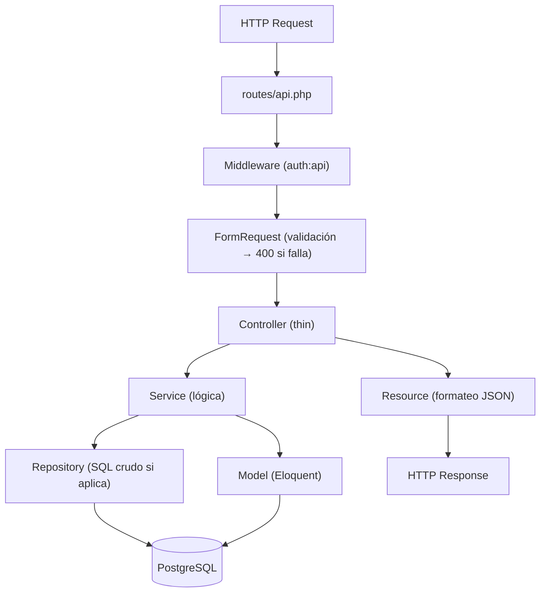

# Arquitectura del Backend — MVC Laravel

**Versión:** 2.0 (Refactor MVC completado)  
**Fecha:** 25 de Septiembre de 2026  
**Rama:** arq-exg  
**Módulos:** 18/18 migrados  

## Patrón Arquitectónico

**MVC Plano minimalista** (sin `app/Http/` y sin `app/Modules/`).

- **Model** (`app/Models/`): Eloquent con lógica de negocio simple + relaciones + scopes.
- **Controller** (`app/Controllers/`): Thin. Orquesta, no contiene lógica.
- **Service** (`app/Services/`): Lógica de negocio compleja (workflows, integraciones, hashing, tokens).
- **Repository** (`app/Repositories/`): SOLO para SQL crudo > 30 líneas (Expedientes, Licencias, Personas, ITSE).
- **Request** (`app/Requests/`): Validación con `failedValidation()` → 400 (paridad estricta con Django).
- **Resource** (`app/Resources/`): Formateo JSON con keys exactas a Django.
- **Exception** (`app/Exceptions/`): Consolidado por dominio.

## Estructura de Directorios

```text
app/
├── Auth/              # Guards JWT (DjangoJwtGuard, DjangoJwtUserProvider)
├── Controllers/       # 1 Controller por módulo (+ Auth/)
├── Exceptions/        # Excepciones consolidadas por dominio
├── Models/            # Eloquent Models (Active Record unificado)
├── Providers/         # ServiceProviders globales
├── Repositories/      # SOLO para SQL crudo (Expedientes, Licencias, Personas, ITSE)
├── Requests/          # FormRequests por módulo
├── Resources/         # API Resources
├── Services/          # Lógica de negocio
│   └── External/      # ReniecService, SunatService
└── Shared/            # Traits/código utilitario compartido
```

## Flujo de una Request



## Los 18 Módulos

| # | Módulo | Tipo | Componentes Principales |
|---|--------|------|-------------------------|
| 1 | **Estados** | CRUD | Controller, Requests, Resource, Model |
| 2 | **Giros** | CRUD | Controller, Requests, Resource, Model |
| 3 | **Tipos de Licencia** | CRUD | Controller, Requests, Resource, Model |
| 4 | **Niveles de Riesgo** | CRUD | Controller, Requests, Resource, Model |
| 5 | **Zonificaciones** | CRUD | Controller, Requests, Resource, Model |
| 6 | **Tipos Doc. Identidad** | CRUD | Controller, Requests, Resource, Model |
| 7 | **Tipos Proc. TUPA** | CRUD | Controller, Requests, Resource, Model |
| 8 | **Unidades Orgánicas** | CRUD / ReadOnly | Controller, Resource, Model |
| 9 | **Usuarios** | Service / Workflows | Controller, Service, Hasher, Requests, Resource, Models |
| 10 | **Inspectores** | Service / Workflows | Controller, Service, Requests, Resource, Model |
| 11 | **Licencias** | Service + Repository | Controller, Service, LicenciaRepository (SQL crudo), Requests, Resources, Models |
| 12 | **ITSE** | Service + Repository | Controller, Service, ItseRepository (SQL crudo), Requests, Resources, Models |
| 13 | **Expedientes** | Service + Repository | Controller, Service, ExpedienteRepository (SQL crudo CTE), CalculadoraDiasHabiles, Requests, Resources, Models |
| 14 | **Archivos** | Service (DRY) | Controller, ArchivoService (unificado para Licencias, ITSE, Expedientes), Resource, Models |
| 15 | **Personas** | Service + Repository | Controller, Service, PersonaRepository (CTE + STRING_AGG), Requests, Resources, Models |
| 16 | **Pide (RENIEC + SUNAT)** | External Services | Controller, ReniecService, SunatService, Requests, Exceptions (502 passthrough) |
| 17 | **Seguridad** | Auth / Hasher / JWT | JwtAuthController, UserController, DjangoPbkdf2Hasher, DjangoJwtTokenService, Requests, UserAuthResource, Exceptions |
| 18 | **Base Server / Global** | Utility | Fecha servidor, OAuth callback, AppServiceProvider |

## Paridad con Django

- **100% byte-a-byte** en endpoints críticos.
- **Hasher `pbkdf2_sha256`** compatible con 720k+ iteraciones.
- **JWT SimpleJWT** con claims exactos (`user_id` string, `role`, `ruc`, `token_type`, `jti`).
- **Status codes replicados:** 200, 201, 204, 400, 401, 404, 409, 502, 500.
- **Mensajes de error exactos** en fallas de validación e integraciones upstream.

## Decisiones Clave

- **Sin `app/Http/`**: Estructura plana, eliminando anidamientos innecesarios.
- **Sin `app/Modules/`**: Retorno a MVC estándar de Laravel, maximizando simplicidad y velocidad de desarrollo.
- **Repository selectivo**: Exclusivamente para consultas SQL complejas o masivas (>30 líneas / CTEs).
- **`app/Auth/` intacto**: Guards y UserProviders custom mantenidos sin alteraciones.
