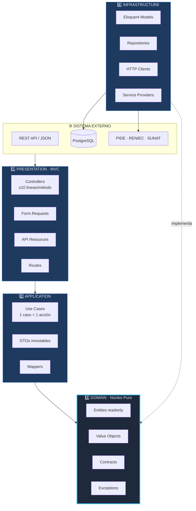
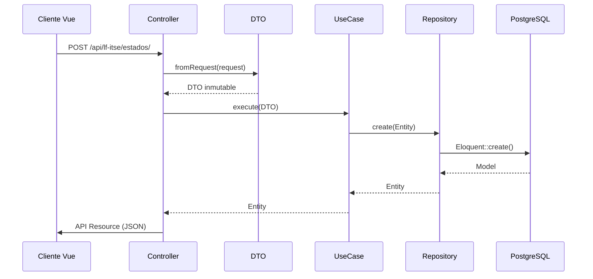
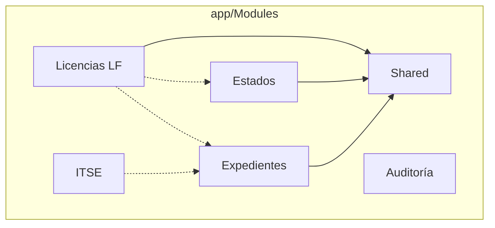
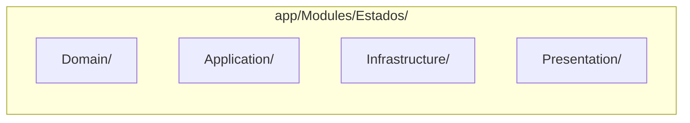
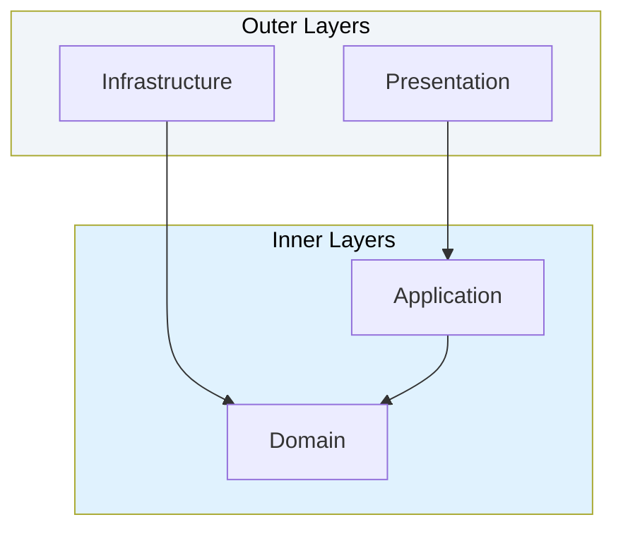
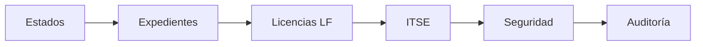
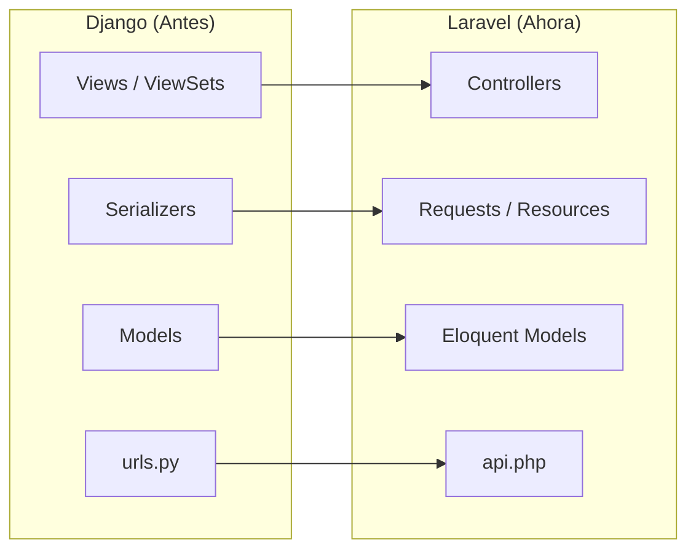
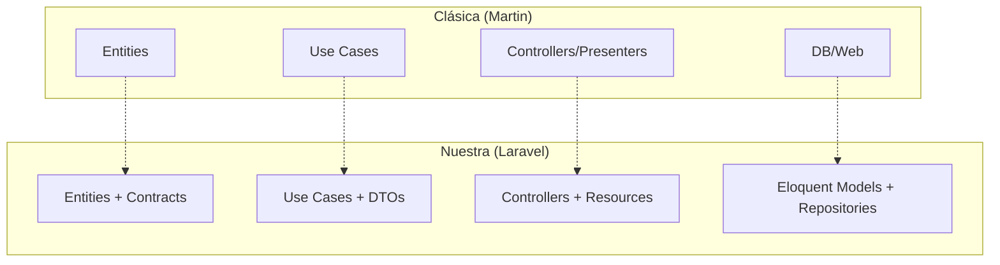

# 🏛️ Arquitectura del Backend: PHP/Laravel 11 + Clean Architecture

Este documento establece los lineamientos arquitectónicos inmutables para el backend del proyecto. Cualquier nuevo módulo DEBE apegarse a estas reglas.

## 1. Capas de Clean Architecture

## 2. Flujo de una petición HTTP

## 3. Estructura Modular por Bounded Contexts

## 4. Estructura Interna de un Módulo (Ej. Estados)

## 5. Regla de Dependencias

## 6. Roadmap de Migración

## 7. Comparativa Django vs Laravel (Mapping)

## 8. Clean Architecture Clásica vs Aplicada (PHP)

