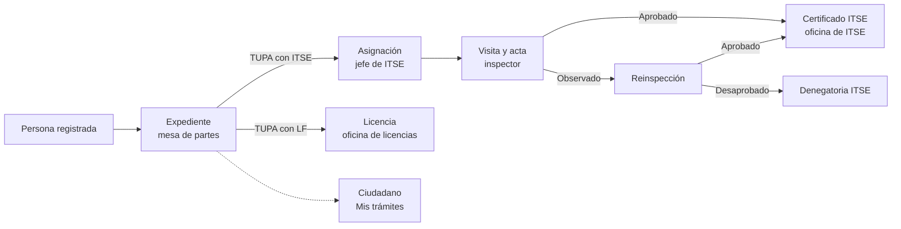

# Flujo del trámite — Sistema LF-ITSE

Cómo avanza una solicitud desde que llega a mesa de partes hasta que el ciudadano tiene su licencia y su
certificado ITSE. Para saber qué casillas necesita cada persona, ver [`PERFILES_Y_ACCESOS.md`](PERFILES_Y_ACCESOS.md).

## 1. La persona

Todo se liga por el **número de documento** (DNI, RUC o carné de extranjería). Antes del expediente, la persona debe
estar en **Personas / Administrados**:

- Persona natural (DNI) o jurídica (RUC). Una persona puede tener varios documentos.
- Con la PIDE configurada, los datos se traen de RENIEC o SUNAT al escribir el documento.
- Una persona que ya figura en trámites no se borra.

## 2. Expediente (mesa de partes — casilla *Expedientes*)

Se registra en `/admin/expedientes` con:

| Campo | Regla |
|---|---|
| Número | Opcional: si se deja vacío, el sistema asigna el siguiente. No se repite |
| Fecha de recepción | Obligatoria |
| Procedimiento TUPA | Obligatorio y activo. Define si el trámite incluye **licencia (LF)**, **ITSE** o ambos, y el plazo |
| Solicitante | Obligatorio: se busca por DNI, RUC o nombre |
| Representante legal | Opcional (por ejemplo, el gerente de una empresa) |

**Plazo.** La fecha límite de atención se calcula en **días hábiles**: sin sábados, domingos ni feriados (tablas de
feriados anuales y recurrentes). Unos días antes se marca la alerta de vencimiento.

Después de registrado:

- **Ampliación de plazo**: una sola vez por expediente, con días mayores a cero.
- **Anulación**: con motivo. No se puede anular si ya tiene licencia o certificado ITSE emitido. Un expediente
  anulado no admite cambios ni nuevos trámites.
- **Archivos adjuntos**: se suben y se dan de baja con motivo; la baja deja constancia y no borra el archivo.

Las oficinas de licencias e ITSE ven los expedientes en modo consulta: listan, abren los adjuntos y registran la
denegatoria que les toca, pero no los crean ni editan.

## 3. Inspección ITSE (jefe de ITSE e inspectores)

Solo para procedimientos que incluyen ITSE.

**Asignación** (`/admin/itse/asignaciones`, casilla *Jefe de ITSE*):

- Un **responsable** (registra y firma el acta) y hasta **3 acompañantes**.
- La fecha de visita es opcional: sin fecha, el inspector la coordina con el administrado.
- Se puede reprogramar, cambiar el equipo o reasignar. Quitar a alguien del equipo no lo borra: queda la constancia.
- Un expediente no se asigna dos veces mientras tenga una asignación abierta.

**Acta** (`/inspector`, casilla *Inspector*). La registra solo el responsable, desde el celular:

- Número de acta, fecha de visita (no futura), área en m² y aforo (máximo 2 personas por m²).
- **Checklist** de cuatro grupos: extintores, señalización, luces de emergencia y tableros eléctricos. Cada uno
  *Cumple*, *No cumple* o *No aplica*.
- **Fotos obligatorias**: la fachada siempre; extintores y tableros, salvo que no apliquen al local.
- Si algo no cumple, las observaciones son obligatorias.

**El resultado no lo elige el inspector: sale del checklist.**

| Visita | Todo cumple | Algo no cumple |
|---|---|---|
| 1.ª visita | **Aprobado** | **Observado**: plazo de subsanación de 2 o 3 días y luego la reinspección |
| Reinspección | **Aprobado** | **Desaprobado**: corresponde denegar la ITSE |

El acta guarda quiénes del equipo asistieron a la visita. El jefe de ITSE puede **anular** un acta con motivo (por
ejemplo, un error de registro); el acta anulada sigue visible y se registra una nueva.

## 4. Certificado ITSE (oficina de ITSE — casilla *ITSE*)

Se emite en `/admin/itse` sobre el expediente, indicando titular y conductor del local.

- Exige un **acta Aprobada** vigente para expedientes recibidos desde la fecha configurada en
  `ITSE_ACTA_OBLIGATORIA_DESDE` (si está vacía, para todos).
- No se emite sobre un expediente anulado ni sobre uno con la denegatoria de ITSE registrada.
- Luego se puede registrar la notificación, inactivarlo (con motivo del catálogo de estados) y adjuntar archivos.
- `/admin/itse/por-renovar` lista los certificados próximos a vencer.

## 5. Licencia de funcionamiento (oficina de licencias — casilla *Licencias*)

Se emite en `/admin/licencias-funcionamiento` sobre el expediente: tipo de licencia, titular, conductor (vacío =
el titular conduce), nivel de riesgo, zonificación, giros y recibo de pago.

- No se emite ni se edita sobre un expediente anulado o con la denegatoria de licencia registrada.
- El número de licencia y el recibo de pago no se repiten.
- Después: notificación, inactivación con motivo y adjuntos.

## 6. Denegatorias

Cuando la solicitud no procede, se registra la **denegatoria** desde el expediente:

| Denegatoria | Quién | Requisito |
|---|---|---|
| De ITSE | Casilla *ITSE* (o el jefe de ITSE tras una reinspección Desaprobada) | El procedimiento incluye ITSE |
| De licencia | Casilla *Licencias* | El procedimiento incluye licencia |

Cada denegatoria se registra una sola vez y no se deshace. Aparecen en los reportes de denegadas.

## 7. Estado que ve el ciudadano

La consulta pública (`/consulta`) y "Mis trámites" (`/ciudadano`) muestran un estado simple, calculado así:

**Expediente**

| Estado | Cuándo |
|---|---|
| ANULADO | Fue anulado |
| EN TRÁMITE | Falta emitir o denegar la licencia o el ITSE que pide su procedimiento |
| IMPROCEDENTE | No se emitió nada y se denegó lo que pedía |
| ATENDIDO | Ya se resolvió todo lo que pedía |

Si el procedimiento incluye ITSE, además se muestra el **avance de la inspección**: pendiente de asignar, por
programar, programada (con fecha), observada (con el plazo para subsanar), aprobada o desaprobada.

**Licencia o certificado ITSE**: VIGENTE, VENCIDO (pasó su fecha de vencimiento; sin fecha = vigencia
indeterminada) o INACTIVO.

El ciudadano nunca ve datos de otras personas, el nombre del inspector ni el detalle o las fotos del acta.

## 8. Cuenta del ciudadano

- Se crea en `/ciudadano/ingresar` con el DNI o RUC y el **número de uno de sus expedientes** (está en su cargo de
  recepción). Esa es la prueba de que el documento es suyo.
- Ve todo lo que está a su nombre: expedientes donde es solicitante o representante, y licencias e ITSE donde es
  titular o conductor.
- Si olvida la clave, la restablece igual, con el documento y un número de expediente.
- Los intentos están limitados para impedir pruebas en masa.
