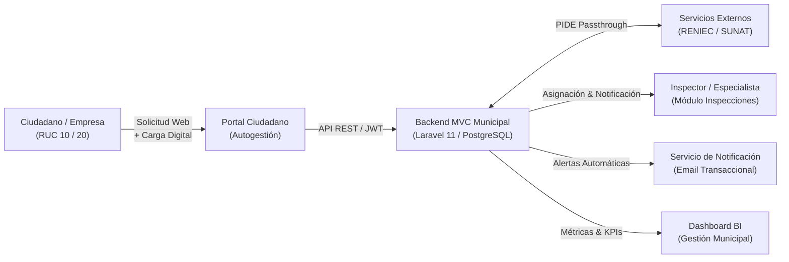
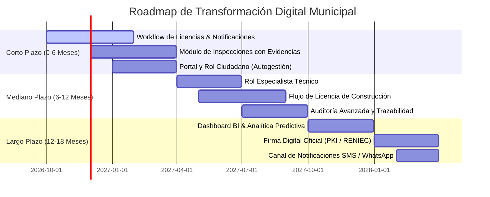

# TOGAF ADM — Resumen Ejecutivo de Arquitectura Empresarial
## Modernización del Proceso de Licencias y Trámites Municipales

**Organización:** Municipalidad Distrital  
**Proyecto:** Plataforma Integral de Licencias y Gestión Territorial  
**Metodología:** TOGAF ADM Versión 9.2 / 10  
**Fecha de Publicación:** 2026-09-25  
**Estado:** Aprobado / Fase 0  

---

## 1. Declaración del Problema

Actualmente, la gestión de trámites municipales (Licencias de Funcionamiento, ITSE y Licencias de Construcción) opera bajo un modelo predominantemente manual, fragmentado y sustentado en expedientes físicos de papel:
- **Demoras y cuellos de botella:** El tiempo de atención promedio por trámite alcanza los 45 minutos de interacción en ventanilla y semanas para la resolución administrativa.
- **Pérdida de trazabilidad y documentos:** La dispersión física de carpetas y resoluciones genera pérdidas de expedientes y descoordinación entre la Subgerencia de Desarrollo Económico y Licencias (SGDEL) y la Subgerencia de Gestión del Riesgo de Desastres (SGRD).
- **Duplicidad de información:** Más del 35% de los datos recolectados se vuelven a solicitar en ventanilla debido a la falta de interoperabilidad con registros oficiales (RENIEC, SUNAT).
- **Inspecciones sin evidencia digital:** Las inspecciones técnicas (ITSE) se realizan con fichas manuscritas sin georreferenciación ni fotografías vinculadas de forma inmutable.
- **Toma de decisiones a ciegas:** La ausencia de analítica centralizada impide a la alta gerencia y a la alcaldía conocer cuellos de botella, recaudación y tiempos de respuesta en tiempo real.

---

## 2. Visión de la Solución Arquitectural

Se plantea una **Arquitectura Empresarial Integral** que articula los procesos de negocio con una plataforma tecnológica digital de alto rendimiento basada en un **Backend MVC plano (Laravel 11 / PHP 8.5 / PostgreSQL)**, desacoplado e integrado con un **Portal Ciudadano**:

### Pilares Fundamentales de la Solución
1. **Trámite 100% Digital y Desatendido:** El ciudadano o empresa inicia el trámite digitalmente sin pagos directos en el sistema (sin pasarela ni validación de baucher dentro del aplicativo core).
2. **Interoperabilidad Automática (PIDE):** Validación instantánea de identidad (RENIEC) y estado tributario (SUNAT) sin exigir copias de DNI ni fichas RUC.
3. **Flujo de Trabajo Orquestado (Workflow):** Máquina de estados determinista de 10 estados para la Licencia de Funcionamiento con historial de auditoría inmutable.
4. **Inspecciones Técnicas Digitalizadas:** Registro móvil de evidencias fotográficas y observaciones técnicas directamente vinculadas al expediente.
5. **Comunicación Proactiva:** Notificaciones automatizadas vía correo electrónico ante cada cambio de estado, observación o emisión.

---

## 3. Beneficios Esperados

### Para la Ciudadanía y el Sector Comercial
- Reducción drástica del tiempo dedicado a gestiones presenciales.
- Transparencia total: consulta de estado del expediente en tiempo real desde cualquier dispositivo.
- Supresión de barreras burocráticas y requerimientos redundantes.

### Para la Gestión Municipal
- Trazabilidad y rendición de cuentas: cada cambio de estado, observación o inspección queda auditado con autor, fecha y motivo.
- Eficiencia operativa: eliminación del archivo físico activo y optimización de las rutas de inspección.
- Gobierno basado en datos: disponibilidad de 5 KPIs operacionales en tiempo real para la toma de decisiones estratégicas.

---

## 4. Cuadro de 5 Indicadores Clave de Desempeño

| # | Indicador Estratégico | Situación Actual (AS-IS) | Meta de Arquitectura (TO-BE) | Mecanismo de Medición |
|---|-----------------------|--------------------------|------------------------------|-----------------------|
| **1** | **Tiempo de atención por trámite** | 45 minutos (ventanilla) | **≤ 15 minutos** (digital) | Telemetría del sistema / Logs de inicio-fin |
| **2** | **Porcentaje de trámites 100% digitales** | 10% (trámites presenciales) | **≥ 70%** del volumen total | Conteo de expedientes vía API vs ventanilla |
| **3** | **Tasa de información duplicada** | 35% de datos reingresados | **< 5%** | Auditoría de integridad de base de datos |
| **4** | **Disponibilidad operativa del servicio** | 95.0% (caídas frecuentes) | **≥ 99.5%** mensual | Monitoreo de Uptime / Healthchecks |
| **5** | **Volumen mensual de reclamos por demora** | 120 reclamos / mes | **< 40 reclamos / mes** | Libro de reclamaciones digital / Mesa de partes |

---

## 5. Hoja de Ruta Resumida (Roadmap 18 Meses)

1. **Horizonte 1 (0 – 6 Meses): Cimientos Digitales y Operación Ágil**
   - Implementación del Workflow de Licencias (10 estados deterministas).
   - Servicio de Notificaciones automáticas por correo electrónico.
   - Módulo de Inspecciones con soporte de evidencias fotográficas.
   - Portal Ciudadano para inicio de trámites y consulta de estado.
2. **Horizonte 2 (6 – 12 Meses): Especialización y Expansión Funcional**
   - Incorporación del Rol Especialista Técnico para revisión de planos y expedientes complejos.
   - Digitalización del flujo independiente de Licencia de Construcción.
   - Marco de auditoría integral y control de accesos granular por roles (RBAC).
3. **Horizonte 3 (12 – 18 Meses): Analítica Avanzada y Confianza Digital**
   - Despliegue de Dashboard BI para Alcaldía y Gerencia Municipal.
   - Firma Digital oficial acreditada (estándar nacional eIDAS / PKI).
   - Canal complementario de notificaciones inmediatas vía SMS / mensajería móvil.
