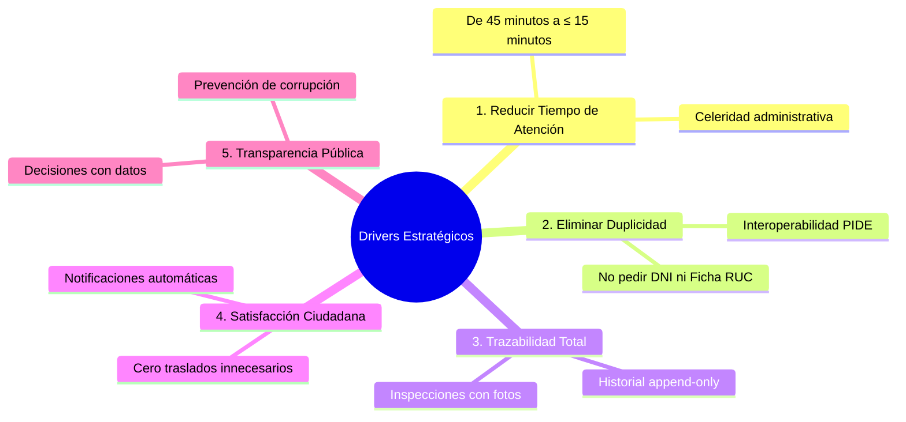
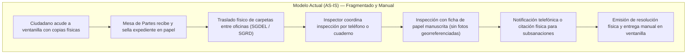

# TOGAF ADM — Fase A: Visión de la Arquitectura (Architecture Vision)

**Organización:** Municipalidad Distrital  
**Proyecto:** Plataforma Integral de Licencias y Gestión Territorial  
**Fase TOGAF:** Fase A  
**Fecha:** 2026-09-25  

---

## 1. Motivadores de Negocio (Business Drivers)

La transformación digital del proceso de licencias responde a 5 motivadores estratégicos institucionales:

1. **Reducción Radical del Tiempo de Atención:** Disminuir el tiempo promedio de atención en ventanilla de 45 minutos a menos de 15 minutos, eliminando las demoras innecesarias y agilizando la emisión formal.
2. **Eliminación de la Duplicidad Documental:** Evitar que el administrado presente copias de documentos emitidos por el propio Estado (DNI, vigencia de poder, ficha RUC), aplicando la interoperabilidad nativa vía PIDE (RENIEC y SUNAT).
3. **Trazabilidad y Auditoría en Tiempo Real:** Garantizar que cada actuación administrativa, dictamen de inspector y resolución emitida cuente con un registro electrónico infalsificable, fechado y atribuible a un usuario responsable.
4. **Elevación de la Satisfacción Ciudadana:** Mejorar la experiencia del vecino y empresario mediante alertas por correo electrónico en cada etapa del trámite y habilitación de consulta en línea 24/7.
5. **Transparencia Institucional y Mitigación de Corrupción:** Asegurar criterios objetivos, públicos y trazables en la zonificación, clasificación de riesgo y dictamen de inspección técnica, cerrando espacios a la discrecionalidad indebida.

---

## 2. Visión del Estado Actual (AS-IS)

El modelo operativo actual refleja las prácticas tradicionales de la administración pública basada en soporte de papel:

### Síntomas y Problemas Identificados en el AS-IS
- **Pérdida y extravío de documentación:** Frecuentes pérdidas de fojas en el tránsito físico entre la Subgerencia de Licencias y Defensa Civil / Riesgos.
- **Opacidad:** El ciudadano desconoce el estado de su trámite hasta que vuelve a hacer fila en la municipalidad.
- **Inconsistencia de criterios:** Falta de reglas de negocio automatizadas para la compatibilidad de uso del suelo y cálculo de días hábiles.
- **Vencimiento de plazos legales:** Sanciones y quejas ciudadanas por superar los plazos máximos fijados en el TUPA institucional.

---

## 3. Visión del Estado Futuro (TO-BE)

La arquitectura destino plantea un entorno completamente digital, automatizado y centrado en el servicio al ciudadano:

```mermaid
flowchart TD
    subgraph TO_BE["Modelo Futuro (TO-BE) — Orquestado y Digital"]
        T1["Ciudadano / Empresa registra solicitud web"] --> T2["Validación automática vía PIDE (RENIEC / SUNAT)"]
        T2 --> T3["Generación de Expediente Digital único en Backend MVC"]
        T3 --> T4["Asignación inteligente y programación de inspección técnica"]
        T4 --> T5["Inspector registra evidencias fotográficas in-situ desde tablet/móvil"]
        T5 --> T6["Dictamen técnico digital y transición en Workflow determinista"]
        T6 --> T7["Notificación inmediata por correo electrónico al ciudadano"]
        T7 --> T8["Emisión digital de licencia con código de verificación QR"]
    end
```

---

## 4. Matriz Comparativa: AS-IS vs. TO-BE

| Dimensión | Situación AS-IS (Actual) | Situación TO-BE (Arquitectura Futura) |
|-----------|--------------------------|---------------------------------------|
| **Canal de Ingreso** | Presencial en mesa de partes física con documentos impresos | Web / Portal Ciudadano responsive disponible 24/7 |
| **Validación de Identidad** | Copia de DNI y ficha RUC en papel revisadas a la vista | Consulta directa y en tiempo real a PIDE (RENIEC y SUNAT) |
| **Flujo de Expediente** | Carpetas físicas que viajan entre pisos y oficinas | Workflow de 10 estados en backend Laravel con historial auditado |
| **Inspección Técnica** | Acta física manuscrita; fotos aisladas en cámaras personales | Registro digital in-situ con evidencias fotográficas subidas a la plataforma |
| **Notificación** | Llamadas telefónicas irregulares o notificación física tardía | Envío automático de correo transaccional (Job asíncrono) en cada hito |
| **Pagos en Sistema** | Dispersión de recibos en ventanilla | Sin pasarela de pago ni baucher en el aplicativo core (desacoplado) |
| **Analítica de Gestión** | Hojas de cálculo aisladas sin consolidación | Dashboard BI con 5 KPIs estratégicos para Alcaldía y Gerencia |

---

## 5. Declaración de Beneficios Cuantitativos y Cualitativos

### Beneficios Cuantitativos
- **-66% en tiempo de ventanilla:** De 45 min a ≤ 15 min por atención.
- **-85% en uso de papel:** Digitalización integral de solicitudes, actas y resoluciones.
- **-60% en quejas por demoras:** De 120 reclamos mensuales a menos de 40.
- **≥ 99.5% de disponibilidad:** Acceso ininterrumpido al portal de trámites.

### Beneficios Cualitativos
- Incremento de la confianza del empresariado local en la agilidad de la gestión municipal.
- Mejora en el clima laboral de los inspectores y especialistas al contar con herramientas ordenadas.
- Cumplimiento estricto del marco normativo nacional en materia de simplificación administrativa.
