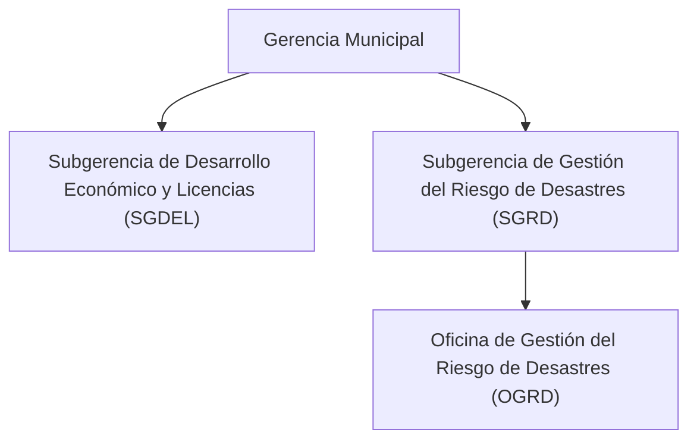
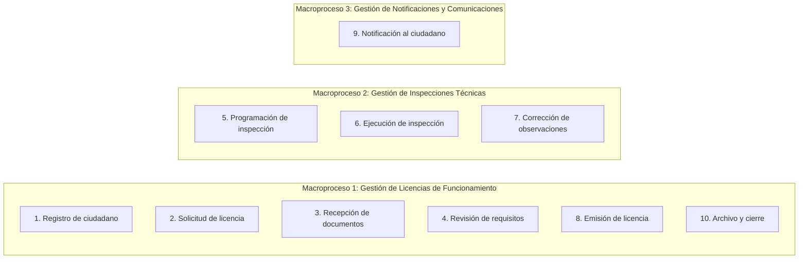
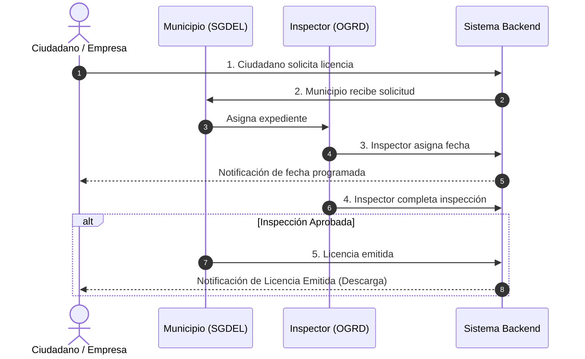

# TOGAF ADM — Fase B: Arquitectura de Negocio (Business Architecture)

**Organización:** Municipalidad Distrital  
**Proyecto:** Plataforma Integral de Licencias y Gestión Territorial  
**Fase TOGAF:** Fase B  
**Fecha:** 2026-09-25  

---

## 1. Estructura Organizacional y Áreas Involucradas

El ámbito de la arquitectura de negocio abarca 3 áreas organizacionales clave:

1. **Subgerencia de Desarrollo Económico y Licencias (SGDEL):** Órgano responsable de evaluar la viabilidad comercial, compatibilidad de zonificación, verificación de requisitos TUPA y emisión formal de la resolución y certificado de Licencia de Funcionamiento.
2. **Subgerencia de Gestión del Riesgo de Desastres (SGRD):** Responsable de la política de seguridad territorial, determinación del nivel de riesgo (Bajo, Medio, Alto, Muy Alto) y supervisión del cuerpo de inspectores.
3. **Oficina de Gestión del Riesgo de Desastres (OGRD):** Unidad operativa a cargo de la asignación de inspectores, coordinación técnica de campo y custodia de las actas de Inspección Técnica de Seguridad en Edificaciones (ITSE).

---

## 2. Actores de Negocio y Roles (8 Mínimos)

| # | Actor / Rol | Tipo | Responsabilidad Principal en el Flujo |
|---|-------------|------|---------------------------------------|
| **1** | **Ciudadano** | Externo | Persona natural (RUC 10) que inicia solicitudes de licencia, consulta estados y subsana observaciones. |
| **2** | **Empresa** | Externo | Persona jurídica (RUC 20) que gestiona solicitudes a través de su representante legal acreditado. |
| **3** | **Inspector** | Interno | Profesional técnico acreditado que realiza la inspección ITSE in-situ, registra actas y adjunta evidencias. |
| **4** | **Especialista** | Interno | Arquitecto/Ingeniero revisor de planos, memorias técnicas y cálculos estructurales en licencias y obras. |
| **5** | **Administrador** | Interno | Gestor de seguridad del sistema, roles, parámetros institucionales, catálogos y monitoreo del servicio. |
| **6** | **Jefe de Licencias** | Interno | Funcionario con facultad resolutiva para aprobar, denegar, observar o emitir las licencias de funcionamiento. |
| **7** | **Mesa de Partes** | Interno | Personal de recepción física y digital encargado de la admisión preliminar de solicitudes extraordinarias. |
| **8** | **Alcalde** | Estratégico | Máxima autoridad ejecutiva local, suscriptor político de las metas de modernización y usuario de KPIs. |

---

## 3. Macroprocesos y Catálogo de Procesos de Negocio

La operación se estructura en **3 Macroprocesos** que articulan **10 Procesos de Negocio**:

### Detalle de los 10 Procesos de Negocio

1. **P01 — Registro de Ciudadano:** Alta de cuenta de usuario autenticada para personas naturales o jurídicas mediante validación PIDE (RENIEC / SUNAT).
2. **P02 — Solicitud de Licencia:** Formulación y envío de la solicitud digital de licencia de funcionamiento seleccionando giro comercial, zonificación y área del establecimiento.
3. **P03 — Recepción de Documentos:** Carga y almacenamiento ordenado de documentos obligatorios (declaraciones juradas, croquis de distribución, memorias).
4. **P04 — Revisión de Requisitos:** Verificación administrativa y normativa por parte del equipo de licencias (SGDEL) sobre zonificación y giro compatible.
5. **P05 — Programación de Inspección:** Asignación de fecha, hora e inspector técnico acreditado por parte de la OGRD según el nivel de riesgo de la edificación.
6. **P06 — Ejecución de Inspección:** Verificación física in-situ del establecimiento, levantamiento de acta técnica digital y captura de evidencias fotográficas.
7. **P07 — Corrección de Observaciones:** Plazo conferido al ciudadano para subsanar deficiencias técnicas de seguridad y cargar evidencias de corrección.
8. **P08 — Emisión de Licencia:** Generación del acto administrativo y certificado digital de Licencia de Funcionamiento con código QR verificable.
9. **P09 — Notificación al Ciudadano:** Despacho automatizado de mensajes de correo electrónico en cada hito del expediente administrativo.
10. **P10 — Archivo y Cierre:** Conclusión formal del expediente administrativo y conservación digital en el repositorio institucional.

---

## 4. Servicios de Negocio (5 Mínimos)

| # | Servicio de Negocio | Descripción | Proveedor | Consumidor | Canal |
|---|---------------------|-------------|-----------|------------|-------|
| **1** | **Solicitud de Licencia** | Servicio de admisión, validación de requisitos y apertura de expediente. | SGDEL | Ciudadano / Empresa | Portal Web |
| **2** | **Inspección Técnica** | Servicio de verificación técnica de condiciones de seguridad (ITSE). | SGRD / OGRD | Administrado | Presencial / App Móvil |
| **3** | **Emisión de Licencia** | Generación oficial del título habilitante con firma digital/código QR. | SGDEL | Ciudadano / Empresa | Descarga Digital |
| **4** | **Notificación al Ciudadano** | Envío de comunicaciones formales y alertas sobre el expediente. | Oficina TI / Sistema | Ciudadano / Empresa | Correo Electrónico |
| **5** | **Consulta de Estado** | Consulta pública y transparente del avance del trámite en tiempo real. | Oficina TI / Sistema | Administrado / Público | Portal Web |

---

## 5. Eventos de Negocio (5 Mínimos)

1. **E01 — Ciudadano solicita licencia:** Disparado cuando el solicitante completa el formulario y adjunta sus documentos en el portal.
2. **E02 — Municipio recibe solicitud:** Disparado al confirmarse la validez formal de los datos y generarse el número de expediente.
3. **E03 — Inspector asigna fecha:** Disparado cuando la OGRD programa la visita técnica en la agenda oficial.
4. **E04 — Inspector completa inspección:** Disparado cuando el inspector firma el acta digital y carga las evidencias de campo.
5. **E05 — Licencia emitida:** Disparado cuando la jefatura aprueba la resolución y el certificado queda listo para entrega.

---

## 6. Objetos de Negocio (8 Mínimos)

| # | Objeto de Negocio | Definición | Atributos Clave | Estado del Ciclo de Vida |
|---|-------------------|------------|-----------------|--------------------------|
| **1** | **Ciudadano / Empresa** | Persona natural o jurídica titular del trámite. | ID, Tipo Doc, Número, Nombre/Razón, Email, Teléfono. | Activo, Inactivo |
| **2** | **Solicitud** | Petición formal de inicio de trámite de habilitación. | UUID, Fecha, Giro comercial, Zonificación, Área (m²). | Presentada, En Evaluación |
| **3** | **Expediente** | Unidad archivística digital que agrupa todos los actuados. | Número correlativo, Año, Código trámite, Fechas clave. | Abierto, En Trámite, Resuelto, Archivado |
| **4** | **Licencia** | Título habilitante otorgado por la entidad municipal. | Número Licencia, Fecha Emisión, Fecha Caducidad, Código QR. | Borrador, Aprobada, Emitida, Anulada |
| **5** | **Inspección** | Acto de fiscalización técnica de seguridad en edificaciones. | Fecha programada, Inspector asignado, Tipo ITSE, Resultado. | Programada, En Proceso, Completada, Reprogramada |
| **6** | **Observación** | Deficiencia técnica identificada que debe ser subsanada. | Descripción, Plazo días, Estado corrección, Evidencia ruta. | Pendiente, Corregida, No Subsanada |
| **7** | **Documento** | Archivo digital cargado como sustento del expediente. | UUID, Nombre, Tipo MIME, Tamaño, Ruta en disco, Hash SHA-256. | Cargado, Validado, Rechazado |
| **8** | **Notificación** | Mensaje formal enviado al administrado. | Destinatario, Asunto, Cuerpo, Tipo alerta, Fecha envío, Leída. | En Cola, Enviada, Fallida, Leída |

---

## 7. Comparativa AS-IS vs. TO-BE en el Negocio

### 5 Problemas Fundamentales del Modelo AS-IS
1. **Registro manual en ventanilla:** Ocasiona colas prolongadas, digitación errónea de datos personales y duplicidad de información existente.
2. **Documentos en papel y expedientes dispersos:** Pérdida frecuente de fojas, ausencia de copias de respaldo y falta de trazabilidad en el tránsito interdepartamental.
3. **Notificaciones por teléfono o citaciones físicas:** Altas tasas de inasistencia a inspecciones, retraso en la notificación de observaciones y quejas vecinales.
4. **Inspecciones técnicas sin evidencia digital:** Dictámenes sustentados en fichas físicas sujetas a deterioro, sin fotografías georreferenciadas que respalden el resultado.
5. **Ausencia de dashboard directivo:** La alta gerencia y la alcaldía no disponen de indicadores para balancear la carga de inspectores ni detectar cuellos de botella.

### 5 Cambios Transformacionales del Modelo TO-BE
1. **Registro único digital interoperable:** Autenticación directa y validación contra RENIEC y SUNAT mediante PIDE en menos de 2 segundos.
2. **Expediente digital único y trazable:** Repositorio centralizado con control de versiones y trazabilidad de cada fojas en formato PDF/A.
3. **Notificaciones automáticas por correo electrónico:** Despacho inmediato y registro de confirmación de envío ante cada hito del workflow.
4. **Sistema de inspecciones con repositorio de evidencias:** Carga in-situ de fotografías y actas digitales asociadas directamente a la inspección.
5. **Dashboard de control de gestión con 5 KPIs:** Visualización ejecutiva en tiempo real de tiempos de ciclo, volumen de trámites y tasas de aprobación.
