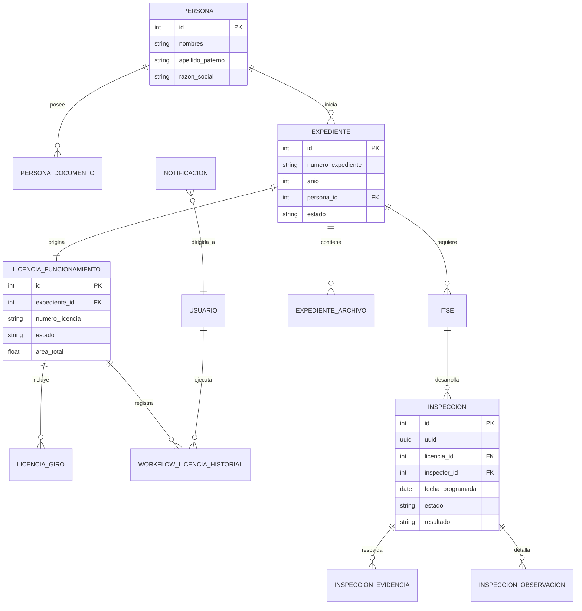
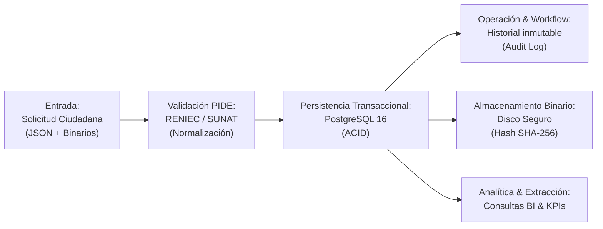
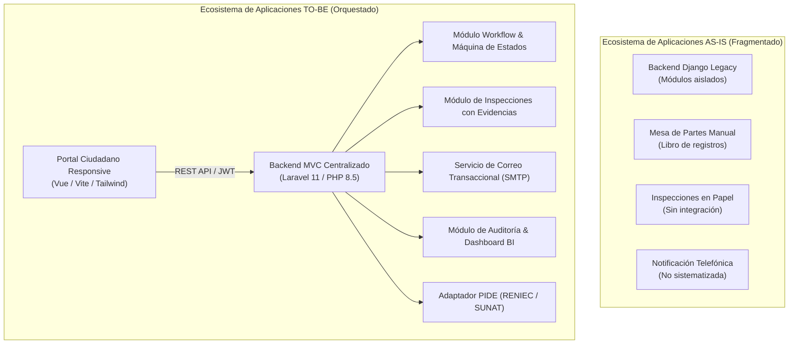

# TOGAF ADM — Fase C: Arquitectura de Sistemas de Información (Data & Applications)

**Organización:** Municipalidad Distrital  
**Proyecto:** Plataforma Integral de Licencias y Gestión Territorial  
**Fase TOGAF:** Fase C  
**Fecha:** 2026-09-25  

---

## 1. Arquitectura de Datos (Data Architecture)

La arquitectura de datos estructura los activos informacionales de la municipalidad garantizando consistencia, integridad referencial y supresión de duplicidades.

### 1.1 Entidades y Modelo Conceptual de Datos

### 1.2 Fuentes de Datos y Eliminación de Duplicidades

| Entidad / Dominio | Fuente Primaria AS-IS | Problema de Duplicidad Detectado | Fuente Primaria TO-BE (Arquitectura) |
|-------------------|-----------------------|----------------------------------|---------------------------------------|
| **Personas Naturales** | Registro manual en ventanilla | DNI digitado con errores; copias físicas en cada trámite. | **PIDE RENIEC** (Consulta en tiempo real vía passthrough). |
| **Personas Jurídicas** | Copia de ficha RUC en papel | Información tributaria desactualizada o con estado inactivo. | **PIDE SUNAT** (Consulta directa del estado RUC y domicilio fiscal). |
| **Zonificación y Usos** | Catastro impreso y Excel | Conflictos entre el plano catastral y la memoria del inspector. | **Tabla `zonificaciones` centralizada** en PostgreSQL. |
| **Expediente e Historial**| Carpetas físicas de archivo | Pérdida de resoluciones y fechas contradictorias. | **Tabla `workflow_licencia_historial` append-only**. |
| **Evidencias de Inspección**| Archivos locales en cámaras/PCs | Fotos sin trazabilidad de fecha ni inspector responsable. | **Tabla `inspeccion_evidencias`** con hashes SHA-256 en almacenamiento seguro. |

### 1.3 Ciclo de Vida y Flujo de Datos

---

## 2. Arquitectura de Aplicaciones (Application Architecture)

### 2.1 Comparación de Ecosistemas: AS-IS vs. TO-BE

### 2.2 Componentes de Aplicación en el Backend Laravel 11 MVC

1. **Capa de Controladores (`app/Controllers/`):** 19 controladores delgados que gestionan las peticiones HTTP, delegan la lógica al Service y devuelven Resources normalizados.
2. **Capa de Servicios de Negocio (`app/Services/`):** Contiene la lógica orquestadora:
   - `LicenciaService` y `WorkflowLicenciaService`: Máquina de estados determinista.
   - `InspeccionService`: Manejo de programación, ejecución y evidencias.
   - `NotificacionService`: Formulación y encolado de correos electrónicos.
   - `ReniecService` y `SunatService`: Integración con servicios externos vía Http facade.
3. **Capa de Repositorios Especializados (`app/Repositories/`):** 4 repositorios dedicados a consultas complejas SQL crudo (CTEs, agregaciones masivas y optimizaciones de búsqueda).
4. **Capa de Validación (`app/Requests/`):** 52 FormRequests que aseguran que ningún payload inconsistente ingrese a la capa de dominio.
5. **Capa de Transformación (`app/Resources/`):** 25 API Resources que aseguran contratos JSON compatibles con Django y desacoplados del esquema físico de BD.
6. **Mecanismo de Autenticación (`app/Auth/`):** Guards y Providers personalizados compatibles con JWT de Django (SimpleJWT) y hashes PBKDF2.

### 2.3 Matriz de Trazabilidad: Aplicación vs. Función de Negocio

| Componente de Aplicación | Solicitud de Licencia | Revisión Técnica | Programación ITSE | Ejecución ITSE | Notificaciones | Emisión Licencia |
|--------------------------|:---------------------:|:----------------:|:-----------------:|:--------------:|:--------------:|:----------------:|
| **Portal Ciudadano** | **X** | | | | | **X** (Descarga) |
| **LicenciaController / Service** | **X** | **X** | | | | **X** |
| **WorkflowLicenciaService** | **X** | **X** | **X** | **X** | | **X** |
| **InspeccionController / Service**| | | **X** | **X** | | |
| **NotificacionService / Jobs** | **X** | **X** | **X** | **X** | **X** | **X** |
| **PIDE Adapter (Reniec/Sunat)** | **X** | | | | | |
| **Dashboard BI Controller** | | **X** | **X** | | | **X** |
