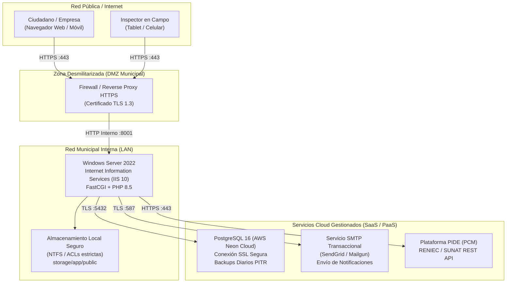

# TOGAF ADM — Fase D: Arquitectura Tecnológica (Technology Architecture)

**Organización:** Municipalidad Distrital  
**Proyecto:** Plataforma Integral de Licencias y Gestión Territorial  
**Fase TOGAF:** Fase D  
**Fecha:** 2026-09-25  

---

## 1. Topología de Infraestructura y Despliegue

La arquitectura tecnológica implementa un modelo híbrido optimizado para cumplir con las restricciones institucionales de la municipalidad, combinando servidores locales Windows Server / IIS para el backend con servicios cloud gestionados para base de datos y correo transaccional.

---

## 2. Pila Tecnológica Estándar

| Capa | Componente Tecnológico | Versión / Detalle | Justificación de Selección |
|------|------------------------|-------------------|-----------------------------|
| **Servidor Físico / VM** | Windows Server | 2022 Datacenter Edition | Sistema operativo estándar homologado por la Oficina de TI municipal. |
| **Servidor Web** | Microsoft IIS | Versión 10.0 con módulo FastCGI | Integración nativa con Windows Server, manejo eficiente de procesos PHP en paralelo. |
| **Entorno de Ejecución** | PHP Runtime | PHP 8.5 x64 (Non-Thread-Safe) | Máximo rendimiento, JIT compiler, tipado estricto (`declare(strict_types=1)`). |
| **Framework Backend** | Laravel | 11.x (MVC Plano) | Robustez en routing, migraciones, ORM Eloquent, soporte nativo de Jobs/Mails. |
| **Base de Datos** | PostgreSQL | 16.x sobre AWS Neon | Cumplimiento ACID, soporte nativo de JSONB, CTEs recursivas, escalabilidad serverless. |
| **Autenticación** | JWT (SimpleJWT compatible) | HMAC-SHA256 con claves simétricas | Compatibilidad estricta con el ecosistema Django preexistente; sesiones stateless. |
| **Mailing / Notificaciones**| SMTP Cloud | SendGrid / Amazon SES | Garantía de entregabilidad del 99.8%, reputación IP limpia, sin saturar el servidor local. |
| **Entorno de Desarrollo** | Docker / Laravel Sail | Ubuntu + PHP 8.5 + pgsql + redis | Paridad absoluta entre entornos de desarrollo y homogeneidad del equipo de desarrollo. |

---

## 3. Seguridad y Control de Accesos

### 3.1 Cifrado y Protocolos
- **Tránsito de Datos:** Obligatoriedad de HTTPS en todas las comunicaciones externas mediante TLS 1.3 con certificados SSL de renovación automática.
- **Conexión a Base de Datos:** Canal encriptado mediante `sslmode=require` hacia el cluster de Neon.
- **Protección de Credenciales:** Hashes de contraseñas mediante algoritmo estándar de Django `pbkdf2_sha256` con 1,200,000 iteraciones y salt criptográfico por usuario.

### 3.2 Control de Acceso Basado en Roles (RBAC)
- Autenticación centralizada por JWT que transporta claims esenciales (`id`, `user_id`, `username`, `role`, `token_type`).
- Middleware de inspección de roles en cada ruta protegida:
  * `role = 'CIUDADANO'`: Acceso restringido a sus propios expedientes y notificaciones.
  * `role = 'INSPECTOR'`: Acceso exclusivo a expedientes e inspecciones asignadas.
  * `role = 'ESPECIALISTA'`: Acceso a evaluación técnica y emisión de observaciones.
  * `role = 'ADMIN'`: Gestión de usuarios, parámetros institucionales y auditoría.

---

## 4. Estrategia de Respaldo y Continuidad Operativa

1. **Backups de Base de Datos:**
   - Snapshots continuos (Point-In-Time Recovery - PITR) provistos por Neon con retención de 14 días.
   - Script automatizado diario mediante `pg_dump` con compresión gzip almacenado en repositorio cifrado secundario.
2. **Backups de Archivos y Evidencias:**
   - Replicación diferencial diaria del directorio de evidencias (`storage/app/public/archivos/`) hacia una unidad de almacenamiento NAS institucional.
3. **Métricas de Recuperación:**
   - **RPO (Recovery Point Objective):** < 15 minutos (máxima pérdida de datos admisible).
   - **RTO (Recovery Time Objective):** < 1 hora (tiempo máximo para restablecer la operatividad total).

---

## 5. Garantía de Alta Disponibilidad (≥ 99.5%)

- **Aislamiento de Tareas Pesadas:** El procesamiento de correos electrónicos y consultas lentas a PIDE se ejecuta mediante Jobs asíncronos en colas de Laravel con reintentos configurables.
- **Monitoreo Continuo:** Endpoints de healthcheck HTTP (`/up` y `/api/health`) consultados cada 60 segundos por sondas externas para alertar incidentes antes de que impacten a los usuarios.
