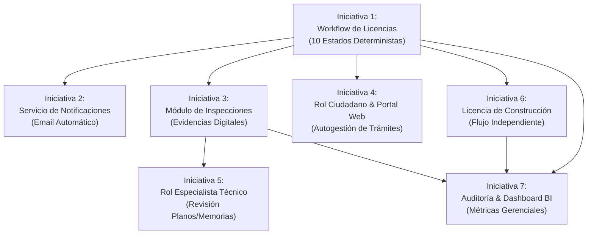

# TOGAF ADM — Fase E: Oportunidades y Soluciones (Opportunities & Solutions)

**Organización:** Municipalidad Distrital  
**Proyecto:** Plataforma Integral de Licencias y Gestión Territorial  
**Fase TOGAF:** Fase E  
**Fecha:** 2026-09-25  

---

## 1. Identificación de Paquetes de Trabajo e Iniciativas

Para cerrar las brechas identificadas entre el estado actual (AS-IS) y el estado objetivo (TO-BE), se han estructurado **7 Iniciativas de Solución** estratégicas y operativas:

---

## 2. Detalle de las 7 Iniciativas de Solución

### Iniciativa 1: Módulo Workflow de Licencia de Funcionamiento
- **Objetivo:** Orquestar el ciclo de vida de la licencia mediante una máquina de estados determinista y auditable.
- **Alcance Funcional:**
  * 10 estados formales: `BORRADOR`, `EN_REVISION`, `OBSERVADO`, `PENDIENTE_INSPECCION`, `INSPECCION_PROGRAMADA`, `INSPECCION_REALIZADA`, `APROBADO`, `RECHAZADO`, `EMITIDO`, `ANULADO`.
  * Validación estricta de transiciones permitidas según rol de usuario.
  * Registro cronológico append-only en `workflow_licencia_historial`.
- **Entregables:** `WorkflowLicenciaService`, `WorkflowController`, `WorkflowResource`, migraciones de base de datos y endpoints REST.

### Iniciativa 2: Módulo de Notificaciones por Correo Electrónico
- **Objetivo:** Automatizar las comunicaciones oficiales hacia administrados e inspectores mediante correos transaccionales.
- **Alcance Funcional:**
  * Encolado asíncrono de emails (`EnviarNotificacionJob`) para no bloquear peticiones HTTP.
  * Plantillas Blade estandarizadas con identidad corporativa municipal (`licencia-creada`, `inspeccion-programada`, `licencia-observada`, `licencia-emitida`).
  * Registro de auditoría de mensajes en base de datos (`notificaciones`).
- **Entregables:** `NotificacionService`, Mails Mailable, plantillas Blade y endpoints para consulta y marcado de lectura.

### Iniciativa 3: Módulo de Inspecciones Técnicas de Seguridad (ITSE)
- **Objetivo:** Digitalizar el proceso de fiscalización de campo, eliminando actas manuscritas y resguardando evidencias fotográficas.
- **Alcance Funcional:**
  * Flujo de estados de inspección: `PROGRAMADA`, `EN_PROCESO`, `COMPLETADA`, `REPROGRAMADA`, `CANCELADA`.
  * Repositorio de evidencias con validación de tipo MIME (fotos, actas PDF) y cálculo de hash SHA-256.
  * Gestión de observaciones técnicas con plazos de subsanación y carga de pruebas de corrección.
- **Entregables:** `InspeccionService`, `InspeccionController`, FormRequests de subida de evidencias, y endpoints especializados.

### Iniciativa 4: Rol Ciudadano y Portal de Autogestión
- **Objetivo:** Facultar al administrado (persona natural RUC 10 o jurídica RUC 20) para gestionar sus trámites de forma desatendida.
- **Alcance Funcional:**
  * Registro y autenticación segura con validación automática PIDE (RENIEC / SUNAT).
  * Formulario guiado de solicitud de licencias con cálculo preventivo de zonificación.
  * Consulta en tiempo real de estados, descarga de certificados digitales con código QR y buzón de notificaciones.
- **Entregables:** Endpoints públicos de solicitud y trazabilidad ciudadana protegidos por token JWT.

### Iniciativa 5: Rol Especialista Técnico
- **Objetivo:** Habilitar un perfil técnico para la revisión rigurosa de expedientes de riesgo Alto y Muy Alto.
- **Alcance Funcional:**
  * Bandeja técnica especializada para revisión de planos arquitectónicos, diagramas unifilares y memorias de cálculo.
  * Capacidad de emitir dictámenes favorables u observaciones técnicas fundamentadas antes del pase a inspección.
- **Entregables:** Middleware de autorización por rol `ESPECIALISTA`, vistas y endpoints de dictamen técnico.

### Iniciativa 6: Módulo de Licencia de Construcción (Flujo Separado)
- **Objetivo:** Implementar el trámite de habilitaciones urbanas y licencias de edificación bajo normativa del Ministerio de Vivienda.
- **Alcance Funcional:**
  * Modelo de datos específico para características de obra: parámetros urbanísticos, área techada, linderos, coordenadas geográficas, plano de ubicación y cálculo de derechos.
  * Flujo de evaluación en comisiones técnicas o revisores urbanos sin mezclarse con Licencias de Funcionamiento.
- **Entregables:** Modelos Eloquent (`LicenciaConstruccion`, `Predio`), controladores, servicios y validaciones específicas.

### Iniciativa 7: Módulo de Auditoría Integral y Dashboard BI
- **Objetivo:** Proveer visibilidad en tiempo real a la alta dirección y garantizar el cumplimiento normativo.
- **Alcance Funcional:**
  * Agregación analítica de los 5 KPIs institucionales (tiempos de ciclo, volumen por giro, carga de inspectores, quejas).
  * Panel directivo interactivo para el Gerente Municipal y Alcalde.
  * Registro de auditoría forense para fiscalizaciones de órganos de control.
- **Entregables:** Vistas analíticas en base de datos, servicio de métricas y endpoints directivos de BI.

---

## 3. Matriz de Dependencias y Priorización

| Iniciativa | Prioridad | Dependencias Técnicas | Complejidad Estimada |
|------------|:---------:|-----------------------|:--------------------:|
| **Iniciativa 1 (Workflow)** | Crítica (Alta) | Backend MVC 2.0 existente | Media |
| **Iniciativa 2 (Notificaciones)** | Crítica (Alta) | Iniciativa 1 (disparadores de eventos) | Baja |
| **Iniciativa 3 (Inspecciones)** | Crítica (Alta) | Iniciativas 1 y 2 | Alta |
| **Iniciativa 4 (Rol Ciudadano)**| Alta | Iniciativa 1 y PIDE | Media |
| **Iniciativa 5 (Especialista)** | Media | Iniciativa 3 | Media |
| **Iniciativa 6 (Construcción)** | Media | Iniciativas 1, 2 y 4 | Alta |
| **Iniciativa 7 (Dashboard BI)** | Media-Alta | Iniciativas 1, 3 y 6 operativas | Media |
