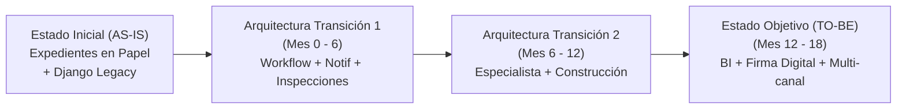
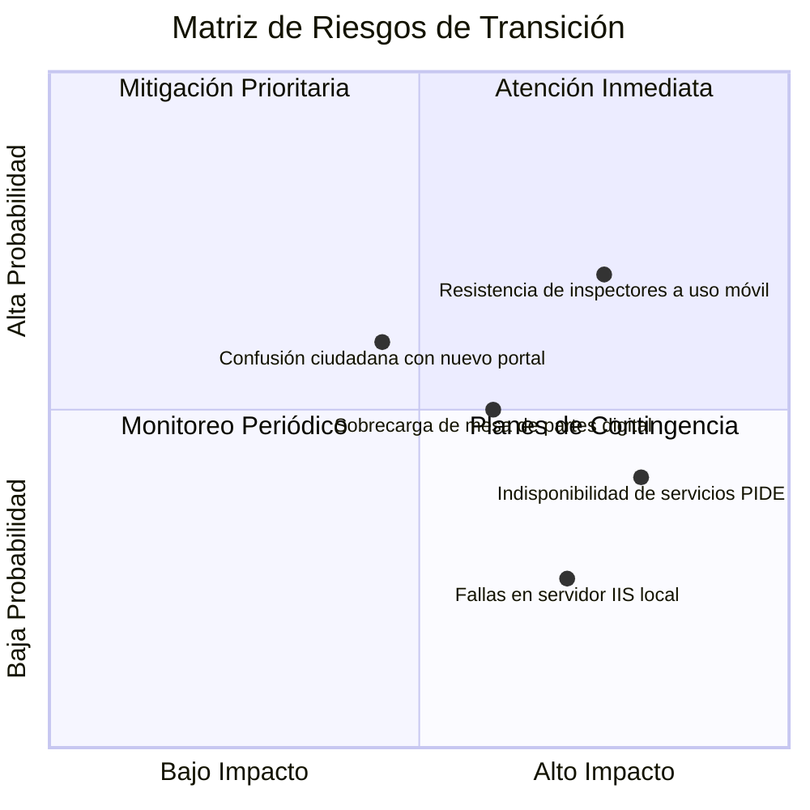

# TOGAF ADM — Fase F: Plan de Migración (Migration Planning)

**Organización:** Municipalidad Distrital  
**Proyecto:** Plataforma Integral de Licencias y Gestión Territorial  
**Fase TOGAF:** Fase F  
**Fecha:** 2026-09-25  

---

## 1. Estrategia de Transición y Arquitecturas de Transición

La migración desde el modelo legacy y físico hacia el modelo digital se realiza mediante un enfoque iterativo por horizontes de tiempo, garantizando la continuidad ininterrumpida de la atención al público.

---

## 2. Horizontes Temporales de Implementación

### Horizonte 1: Corto Plazo (Meses 0 a 6) — Fundamentos y Operación Ágil
- **Objetivo Central:** Digitalizar el flujo crítico de Licencias de Funcionamiento e ITSE.
- **Proyectos Clave:**
  1. *Proyecto 1.1 — Workflow de Licencia:* Implementación de los 10 estados, tabla de historial y endpoints REST.
  2. *Proyecto 1.2 — Notificaciones Transaccionales:* Configuración de servidor SMTP y despacho de emails automáticos.
  3. *Proyecto 1.3 — Módulo de Inspecciones con Evidencias:* Digitalización del acta técnica ITSE y carga de fotografías.
  4. *Proyecto 1.4 — Habilitación del Rol Ciudadano:* Portal web público para inicio de trámite y seguimiento en línea.
- **Hito de Cierre (Mes 6):** Cero expedientes nuevos de Licencia de Funcionamiento tramitados en papel.

### Horizonte 2: Mediano Plazo (Meses 6 a 12) — Especialización y Ampliación de Alcance
- **Objetivo Central:** Incorporar flujos complejos de ingeniería y auditoría de seguridad.
- **Proyectos Clave:**
  1. *Proyecto 2.1 — Rol Especialista Técnico:* Bandeja técnica para revisión de planos arquitectónicos y eléctricos.
  2. *Proyecto 2.2 — Módulo de Licencia de Construcción:* Flujo separado para obras civiles, parámetros urbanísticos y cálculo de derechos.
  3. *Proyecto 2.3 — Marco de Auditoría Forense:* Registro estricto de eventos de seguridad y reportes de trazabilidad.
- **Hito de Cierre (Mes 12):** Integración completa de las áreas de Obras Privadas y Licencias Comerciales sobre la misma plataforma.

### Horizonte 3: Largo Plazo (Meses 12 a 18) — Excelencia Analítica y Confianza Digital
- **Objetivo Central:** Inteligencia de negocios y consolidación de la identidad digital oficial.
- **Proyectos Clave:**
  1. *Proyecto 3.1 — Dashboard BI Directivo:* Consola ejecutiva de KPIs para la Gerencia Municipal y Alcaldía.
  2. *Proyecto 3.2 — Firma Digital Acreditada:* Integración con componentes de firma digital PKI (RENIEC / Indecopi) para resoluciones y certificados con valor probatorio legal.
  3. *Proyecto 3.3 — Canal Complementario SMS / WhatsApp:* Notificaciones inmediatas en telefonía móvil para reducir el absentismo en inspecciones.
- **Hito de Cierre (Mes 18):** Transformación digital completa y certificación ISO 9001 en gestión de trámites.

---

## 3. Plan de Migración de Datos y Coexistencia

| Dominio de Datos | Volumen Estimado | Estrategia de Migración | Validación y Control de Calidad |
|------------------|------------------|-------------------------|----------------------------------|
| **Usuarios y Cuentas** | ~5,000 registros | Migración directa de `auth_user` preservando hashes PBKDF2 y roles. | Verificación de login del 100% de usuarios activos. |
| **Catálogos Maestros** | ~500 registros | Carga inicial de Estados, Giros, Zonificaciones y TUPA mediante Seeders Laravel. | Cotejo exacto con Ordenanza Municipal vigente. |
| **Expedientes Históricos** | ~15,000 expedientes | Carga en lote a tablas de solo lectura para consulta histórica de antecedentes. | Generación de reportes de reconciliación de saldos y números. |
| **Archivos y Planos** | ~200 GB | Indexación y copia a almacenamiento seguro con verificación de hash SHA-256. | Verificación de integridad binaria mediante checksums. |

---

## 4. Gestión de Riesgos de la Migración

### Medidas de Mitigación
1. **Resistencia de Inspectores al Uso de Dispositivos Móviles:** Talleres prácticos con acompañamiento en campo, entrega de tablets con interfaces ergonómicas y simplificación de formularios.
2. **Indisponibilidad Temporal de Servicios PIDE (RENIEC/SUNAT):** Implementación de caché de consultas exitosas y mecanismo de contingencia para validación diferida sin detener el flujo del expediente.
3. **Fallas en Servidor IIS / Infraestructura Local:** Despliegue de scripts automatizados de salud y reinicio supervisado del Application Pool FastCGI.
