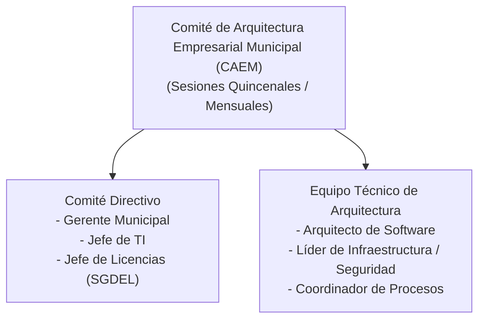
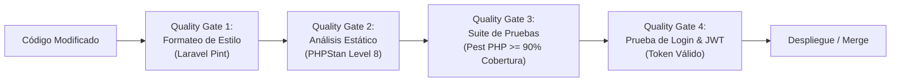
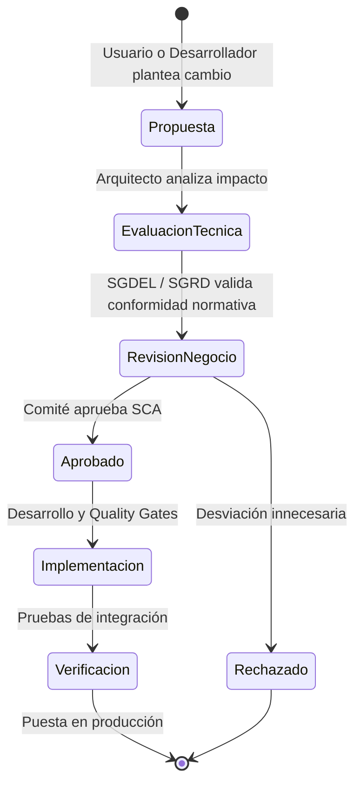

# TOGAF ADM — Fase G: Gobernanza de la Implementación (Implementation Governance)

**Organización:** Municipalidad Distrital  
**Proyecto:** Plataforma Integral de Licencias y Gestión Territorial  
**Fase TOGAF:** Fase G  
**Fecha:** 2026-09-25  

---

## 1. Estructura de Gobernanza: Comité de Arquitectura

Para asegurar que cada entrega técnica se alinee estrictamente con los principios, modelos y requerimientos del proyecto, se formaliza el **Comité de Arquitectura Empresarial Municipal (CAEM)**:

### Roles y Responsabilidades del Comité
- **Gerencia Municipal (Sponsor Operativo):** Valida la alineación estratégica y resolución de controversias entre áreas usuarias.
- **Jefatura de TI (Líder de Gobernanza):** Vela por la integridad tecnológica, observancia de estándares y seguridad de la información.
- **Jefatura de Licencias / Riesgos (Líderes de Negocio):** Aseguran que la funcionalidad cubra fielmente los requerimientos del TUPA y la normativa nacional.
- **Arquitecto de Software (Custodio Técnico):** Revisa el código, aprueba contratos de API y vigila el cumplimiento de las compuertas de calidad.

---

## 2. Puertas de Calidad (Quality Gates) en el Backend

Ningún cambio de código o nueva funcionalidad puede promoverse a entornos de homologación o producción sin superar de forma automatizada las 4 compuertas de calidad del backend:

| Quality Gate | Herramienta | Criterio de Aprobación Innegociable |
|--------------|-------------|-------------------------------------|
| **1. Estilo de Código** | Laravel Pint | `pint --test app/` debe retornar **0 errores**. |
| **2. Tipado y Análisis Estático** | PHPStan / Larastan | `phpstan analyse --level=8 app/` debe retornar **0 errores**. Prohibido el uso de `@phpstan-ignore` no justificado. |
| **3. Pruebas Automatizadas** | Pest PHP | 100% de tests pasando sin fallos ni excepciones no controladas. Mantenimiento del conjunto de tests existente. |
| **4. Integridad de Autenticación** | Curl / Tinker | Endpoint `/api/auth/jwt/create/` debe emitir token válido firmado con clave de Django SimpleJWT. |

---

## 3. Protocolo de Gestión de Cambios de Arquitectura

Cualquier propuesta de modificación a los modelos de datos, flujos de trabajo o contratos de API debe tramitarse mediante una **Solicitud de Cambio de Arquitectura (SCA)**:

---

## 4. Matriz de Monitoreo y Acuerdos de Nivel de Servicio (SLA)

| Servicio / Componente | Métrica de SLA | Umbral Objetivo | Acción Correctiva ante Desvío |
|-----------------------|----------------|-----------------|-------------------------------|
| **Disponibilidad Web** | Uptime mensual | **≥ 99.5%** | Alerta inmediata a TI; balanceo o reinicio de IIS. |
| **Tiempo de Respuesta API**| Percentil 95 (P95) | **< 350 ms** | Optimización de consultas SQL (creación de índices, uso de CTEs en repositorios). |
| **Entregabilidad de Emails**| Tasa de entrega SMTP | **≥ 99.0%** | Verificación de registros SPF, DKIM y DMARC en dominio municipal. |
| **Resolución de Bugs Críticos**| Tiempo de solución | **< 4 horas** | Hotfix prioritario con despliegue de emergencia auditado. |
