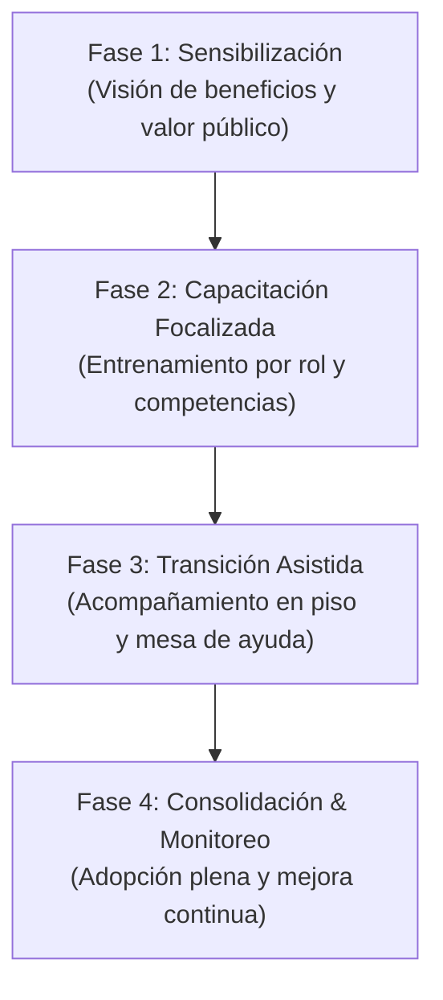
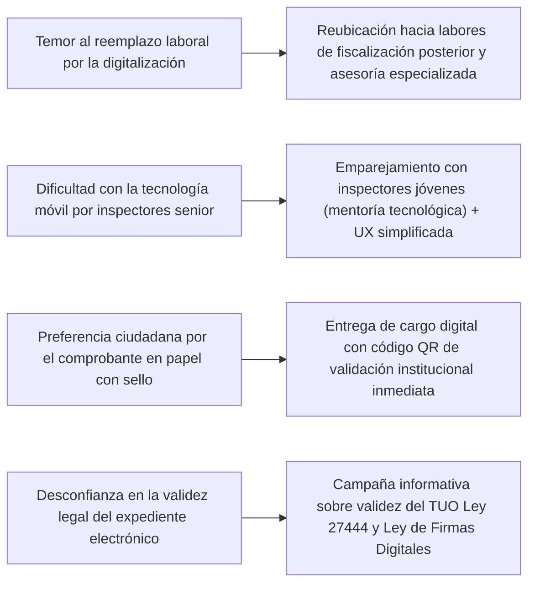

# TOGAF ADM — Fase H: Gestión del Cambio de Arquitectura (Architecture Change Management)

**Organización:** Municipalidad Distrital  
**Proyecto:** Plataforma Integral de Licencias y Gestión Territorial  
**Fase TOGAF:** Fase H  
**Fecha:** 2026-09-25  

---

## 1. Estrategia de Gestión del Cambio Organizacional

La introducción de la nueva plataforma digital transforma profundamente la cultura operativa de la municipalidad, migrando de una rutina basada en el papel a un entorno 100% digital, trazable y transparente. Para mitigar la fricción y asegurar el éxito, se establece un programa de **Evangelización y Gestión del Cambio**:

---

## 2. Plan de Capacitación por Actor del Sistema

| Actor / Rol | Modalidad | Frecuencia | Temario Principal |
|-------------|-----------|------------|-------------------|
| **Ciudadano / Empresa** | Tutoriales interactivos, infografías en portal web y videos cortos | Permanente en portal | Creación de cuenta, llenado de formulario web, carga de croquis/documentos y seguimiento con código de expediente. |
| **Inspectores Municipales** | Talleres prácticos presenciales con tablets en simulaciones de campo | 3 sesiones de 4 horas antes del lanzamiento | Manejo de app móvil, captura y subida de fotos, marcado de observaciones según matriz de riesgo y cierre de actas digitales. |
| **Especialistas Técnicos** | Laboratorios técnicos asistidos | 2 sesiones de 4 horas | Uso de bandeja de entrada técnica, visor de planos digitales, calificación de memorias descriptivas y emisión de dictamen. |
| **Personal de Ventanilla / Mesa de Partes** | Capacitación dual (atención al público y sistema) | 1 semana intensiva | Guía al administrado para auto-registro, resolución de consultas frecuentes y recepción de casos extraordinarios. |
| **Jefatura y Gerencia** | Sesión ejecutiva personalizada | 1 sesión de 2 horas | Interpretación del Dashboard BI, seguimiento de KPIs de atención y reasignación de carga laboral. |

---

## 3. Matriz de Mitigación de la Resistencia al Cambio

---

## 4. Indicadores de Adopción y Salud del Cambio

Para medir la efectividad de la adopción del cambio se monitorean 4 métricas quincenales durante los primeros 6 meses:

1. **Índice de Adopción Ciudadana:** % de expedientes ingresados por portal web respecto al total (Meta: ≥ 70% al sexto mes).
2. **Tiempo de Cierre de Inspección:** Minutos transcurridos entre el término de la visita y la subida de evidencias al sistema (Meta: < 30 minutos in-situ).
3. **Tasa de Contacto a Mesa de Ayuda:** Número de llamadas de soporte técnico por cada 100 trámites (Meta: < 5 tickets por 100 trámites).
4. **Satisfacción del Usuario Interno:** Encuesta trimestral de clima y usabilidad aplicada a inspectores y revisores (Meta: ≥ 85% de satisfacción).
