# TOGAF ADM — Matriz de Análisis de Brechas (Gap Analysis)

**Organización:** Municipalidad Distrital  
**Proyecto:** Plataforma Integral de Licencias y Gestión Territorial  
**Documento:** 10 — Matriz de Brechas  
**Fecha:** 2026-09-25  

---

## 1. Matriz de Brechas de Procesos de Negocio

La siguiente matriz documenta las 5 brechas críticas detectadas entre la situación actual (AS-IS) y la situación objetivo de la arquitectura empresarial (TO-BE):

| # | Proceso de Negocio | Situación Actual (AS-IS) | Problema / Deficiencia | Situación Futura (TO-BE) | Cambio Arquitectural | Beneficio Tangible Esperado |
|---|--------------------|--------------------------|------------------------|--------------------------|----------------------|------------------------------|
| **1** | **Registro e Identificación** | Registro manual en ventanilla física; digitación en libro de partes. | Duplicidad de datos, errores tipográficos en nombres/DNI y demoras de 45 min. | Portal de registro digital único con validación automática PIDE (RENIEC / SUNAT). | Rediseño y automatización de interfaz de entrada; integración REST API. | **-40% a -66% de tiempo** en atención inicial; cero errores de identidad. |
| **2** | **Gestión Documental y Expedientes** | Fojas y planos impresos en papel archivados en carpetas físicas. | Pérdida de documentos durante el traslado entre áreas; deterioro físico y nula trazabilidad. | Expediente digital unificado con carga electrónica y control de hash SHA-256. | Digitalización de repositorio documental; persistencia controlada en BD. | **-90% de pérdida** documental; auditoría inmediata de fojas. |
| **3** | **Notificaciones y Comunicaciones** | Citaciones físicas o llamadas telefónicas esporádicas no registradas. | Notificaciones extemporáneas, inasistencia a inspecciones e insatisfacción vecinal. | Notificaciones automáticas por correo electrónico ante cada cambio de estado. | Automatización mediante Jobs asíncronos en cola y plantillas Blade. | **+60% de satisfacción** ciudadana; cero retrasos por falta de notificación. |
| **4** | **Inspecciones Técnicas (ITSE)** | Actas manuscritas sin fotografías vinculadas al expediente oficial. | Falta de evidencias visuales; cuestionamiento de dictámenes y falta de trazabilidad. | Registro digital in-situ con captura de evidencias fotográficas obligatorias. | Nuevo módulo de inspecciones con almacenamiento seguro de archivos. | **100% de trazabilidad** técnica; respaldo probatorio inmutable. |
| **5** | **Toma de Decisiones y Control** | Reportes mensuales manuales en hojas de cálculo desarticuladas. | Decisiones basadas en suposiciones; desconocimiento de cuellos de botella reales. | Dashboard directivo con 5 KPIs estratégicos calculados en tiempo real. | Capa analítica y vistas agregadas de BI conectadas a PostgreSQL. | Gestión **Data-Driven**; balanceo dinámico de carga entre inspectores. |

---

## 2. Brechas por Capa de Arquitectura (TOGAF ADM)

```mermaid
graph TD
    subgraph Negocio["Capa de Negocio"]
        BG1["Trámites manuales con papel"] -->|Transición| BG2["Workflow automatizado de 10 estados"]
    end
    subgraph Datos["Capa de Datos"]
        DG1["Datos aislados y redundantes"] -->|Transición| DG2["Modelo relacional normalizado + PIDE"]
    end
    subgraph Aplicacion["Capa de Aplicaciones"]
        AG1["Sistemas dispersos / Django legado"] -->|Transición| AG2["Backend Laravel 11 MVC + Portal Web"]
    end
    subgraph Tecnologia["Capa Tecnológica"]
        TG1["Servidores locales sin monitoreo"] -->|Transición| TG2["PostgreSQL Neon + IIS FastCGI + SMTP"]
    end
```

### 2.1 Capa de Negocio (Business Layer Gaps)
- **Brecha:** Los procedimientos administrativos se rigen por costumbres operativas sin una máquina de estados formal.
- **Solución:** Definición taxativa de 10 estados en la Licencia de Funcionamiento con reglas explícitas de transición y perfiles habilitados.

### 2.2 Capa de Datos (Data Layer Gaps)
- **Brecha:** Inconsistencias en nombres de calles, giros y personas por falta de normalización en la captura.
- **Solución:** Modelo relacional unificado en PostgreSQL con claves foráneas estrictas, catálogos maestros TUPA y tablas de auditoría append-only.

### 2.3 Capa de Aplicaciones (Application Layer Gaps)
- **Brecha:** El frontend no disponía de un backend rápido, limpio y con contratos homogéneos; existía sobreingeniería hexagonal de 500 archivos.
- **Solución:** Consolidación en Backend MVC plano de 152 archivos, reducción del 80% del código inerte y exposición de endpoints REST estandarizados con paridad 100% con Django.

### 2.4 Capa de Tecnología (Technology Layer Gaps)
- **Brecha:** Dificultad para mantener paridad entre entornos de desarrollo y producción bajo Windows Server.
- **Solución:** Uso estandarizado de Docker/Sail para desarrollo y configuración optimizada de IIS FastCGI con PHP 8.5 para el despliegue final en producción.
