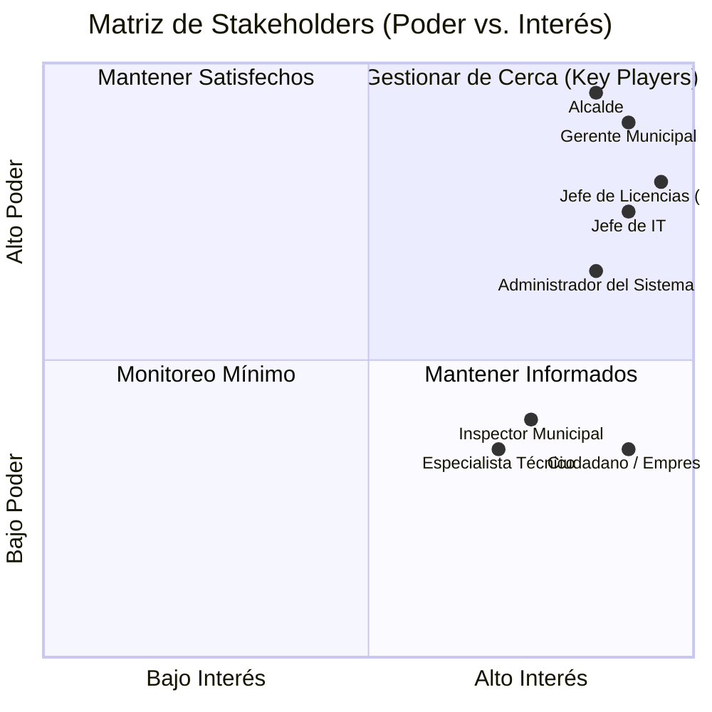

# TOGAF ADM — Catálogo Exhaustivo de Stakeholders (Interesados)

**Organización:** Municipalidad Distrital  
**Proyecto:** Plataforma Integral de Licencias y Gestión Territorial  
**Documento:** 12 — Catálogo de Stakeholders  
**Fecha:** 2026-09-25  

---

## 1. Matriz Poder vs. Interés (Mendelow)

---

## 2. Catálogo Detallado de Interesados

| ID | Stakeholder | Rol / Posición | Intereses y Expectativas | Nivel de Poder | Nivel de Interés | Estrategia de Comunicación |
|----|-------------|----------------|--------------------------|:--------------:|:----------------:|----------------------------|
| **STK-01** | **Alcalde** | Sponsor Político y Máxima Autoridad | Cero quejas ciudadanas, fomento del desarrollo comercial local, modernización y cumplimiento de promesas electorales. | Alto | Alto | Reportes ejecutivos mensuales con KPIs visuales y notas de prensa de logros. |
| **STK-02** | **Gerente Municipal** | Conductor de la Gestión Municipal | Eficiencia operativa, reducción de costos en papel, cumplimiento estricto del POI y mitigación de riesgos legales. | Alto | Alto | Reuniones de avance quincenales y acceso directo al Dashboard BI. |
| **STK-03** | **Jefe de Licencias (SGDEL)** | Líder de Negocio de Licencias | Reducción de mora administrativa, estandarización de criterios TUPA y automatización de la emisión formal. | Alto | Alto | Sesiones semanales de trabajo, co-diseño de reglas del workflow y pruebas conjuntas. |
| **STK-04** | **Jefe de IT** | Líder Técnico de la Transformación | Arquitectura mantenible, seguridad informática, cumplimiento de normativas de interoperabilidad y estabilidad de servidores. | Alto | Alto | Comité de Arquitectura, reportes de monitoreo continuo y control de compuertas de calidad. |
| **STK-05** | **Administrador del Sistema** | Soporte y Operaciones TI | Facilidad para gestionar usuarios, roles, copias de seguridad automáticas y configuración ágil de parámetros. | Medio-Alto | Alto | Manuales técnicos, scripts de automatización y alertas de sistema automáticas. |
| **STK-06** | **Ciudadano / Empresa** | Usuario Final Externo | Trámites sin filas, interfaz intuitiva, sin cobros ocultos ni pedidos redundantes, avisos por email en tiempo real. | Medio-Bajo | Alto | Portal web accesible, notificaciones por correo electrónico y guía paso a paso. |
| **STK-07** | **Inspector Municipal** | Operador Técnico de Campo | Sistema ágil en tablet/móvil para tomar fotos y dictaminar in-situ, sin tener que redigitar actas en la oficina. | Medio-Bajo | Medio-Alto | Talleres de capacitación práctica, soporte técnico en campo y UX simplificada. |
| **STK-08** | **Especialista Técnico** | Revisor Especializado (Riesgo Alto) | Visualizador ágil de planos y memorias técnicas en PDF, registro claro de observaciones técnicas fundamentadas. | Medio-Bajo | Medio-Alto | Capacitación en bandeja técnica digital y retroalimentación periódica de usabilidad. |
