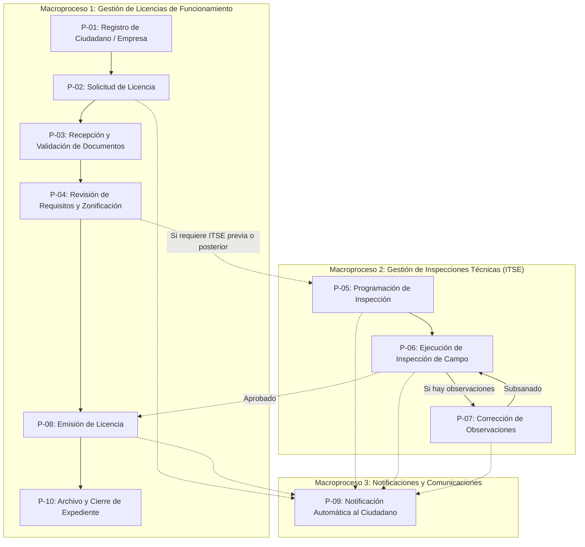

# TOGAF ADM — Catálogo Exhaustivo de Procesos de Negocio

**Organización:** Municipalidad Distrital  
**Proyecto:** Plataforma Integral de Licencias y Gestión Territorial  
**Documento:** 13 — Catálogo de Procesos  
**Fecha:** 2026-09-25  

---

## 1. Mapa General de Procesos

---

## 2. Fichas de los 10 Procesos de Negocio

| ID | Proceso de Negocio | Macroproceso | Actor Líder | Entradas (Inputs) | Salidas (Outputs) | Reglas de Negocio Clave | Sistemas Involucrados |
|----|--------------------|--------------|-------------|-------------------|-------------------|-------------------------|------------------------|
| **P-01** | **Registro de Ciudadano** | MP1: Licencias | Ciudadano / Empresa | DNI o RUC, datos de contacto, contraseña. | Cuenta de usuario activa en `auth_user`, token JWT. | DNI validado con RENIEC; RUC validado con SUNAT en estado Activo y Habido. | Portal Web, PIDE Adapter, `JwtAuthController` |
| **P-02** | **Solicitud de Licencia** | MP1: Licencias | Ciudadano / Empresa | Giro comercial, dirección, área m², nivel de riesgo preliminar. | Registro de solicitud en `licencias_funcionamiento` (estado BORRADOR). | El giro debe pertenecer a la matriz de compatibilidad de zonificación distrital. | Portal Web, `LicenciaController`, `LicenciaService` |
| **P-03** | **Recepción de Documentos** | MP1: Licencias | Ciudadano / Empresa | Croquis de ubicación, plano de distribución, declaraciones juradas en PDF. | Registros en `expediente_archivos` con hash SHA-256 generado. | Archivos únicamente en PDF o JPG; peso máximo 10MB por archivo; verificación antivirus. | Portal Web, `ArchivoController`, `ArchivoService` |
| **P-04** | **Revisión de Requisitos** | MP1: Licencias | SGDEL (Revisor) | Expediente digital y documentos cargados. | Estado actualizado a `EN_REVISION` o `OBSERVADO`; dictamen preliminar. | Plazo máximo de calificación: 2 días hábiles (calculado sin contar feriados institucionales). | Backend MVC, `ExpedienteController`, `CalculadoraDiasHabiles` |
| **P-05** | **Programación de Inspección** | MP2: Inspecciones | OGRD / Coordinador | Expediente apto para ITSE, disponibilidad de inspectores. | Registro en `inspecciones` (estado PROGRAMADA), asignación de inspector. | No exceder la carga máxima de 4 inspecciones diarias por inspector técnico. | Backend MVC, `InspeccionController`, `InspeccionService` |
| **P-06** | **Ejecución de Inspección** | MP2: Inspecciones | Inspector Municipal | Agenda de inspección, verificación física in-situ del local. | Acta técnica digital firmada, evidencias fotográficas, resultado (APROBADO/OBSERVADO/RECHAZADO). | Mínimo 3 fotografías obligatorias de tableros eléctricos, extintores y señalética. | App Móvil / Web Inspector, `InspeccionController`, Storage |
| **P-07** | **Corrección de Observaciones** | MP2: Inspecciones | Ciudadano / Empresa | Notificación de observaciones técnicas, plazo conferido. | Registro de evidencias de subsanación en `inspeccion_observaciones`. | Plazo improrrogable según TUPA (máximo 5 días hábiles para subsanar). | Portal Web, `InspeccionController`, `WorkflowLicenciaService` |
| **P-08** | **Emisión de Licencia** | MP1: Licencias | Jefe de Licencias (SGDEL) | Expediente completo con ITSE favorable. | Resolución de Subgerencia y Certificado Digital con QR oficial (estado EMITIDO). | Requiere dictamen favorable tanto de zonificación como de inspección de seguridad. | Backend MVC, `LicenciaController`, Generador QR / PDF |
| **P-09** | **Notificación al Ciudadano** | MP3: Notificaciones | Sistema (Automático) | Evento de cambio de estado o programación en el workflow. | Correo electrónico entregado al administrado; registro en `notificaciones`. | Despacho asíncrono en segundo plano; registro de acuse de recibo y fecha de envío. | Backend MVC, `NotificacionService`, SMTP SendGrid |
| **P-10** | **Archivo y Cierre** | MP1: Licencias | Mesa de Partes / SGDEL | Expediente resuelto en estado final (EMITIDO, RECHAZADO o ANULADO). | Expediente archivado digitalmente con metadatos de conservación permanente. | Conservación digital inmutable; prohibida cualquier modificación posterior. | Backend MVC, `ExpedienteController`, Repositorio Digital |
