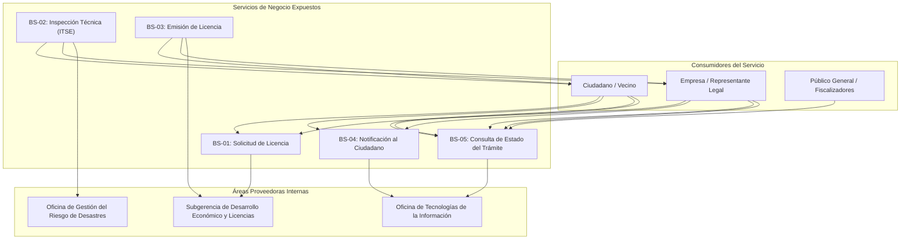

# TOGAF ADM — Catálogo de Servicios de Negocio (Business Services)

**Organización:** Municipalidad Distrital  
**Proyecto:** Plataforma Integral de Licencias y Gestión Territorial  
**Documento:** 14 — Catálogo de Servicios  
**Fecha:** 2026-09-25  

---

## 1. Arquitectura de Servicios de Negocio

Los Servicios de Negocio representan las capacidades que la organización municipal expone hacia los ciudadanos, empresas y actores institucionales para satisfacer sus necesidades de trámite territorial:

---

## 2. Fichas Técnicas de los 5 Servicios de Negocio

### BS-01: Servicio de Solicitud de Licencia
- **Descripción:** Admisión digital de la petición formal para el ejercicio de actividades económicas en el distrito, incluyendo la validación de identidad y verificación preliminar de compatibilidad de zonificación.
- **Canal de Entrega:** Portal Web responsive (autoservicio 24/7).
- **Consumidores:** Personas naturales (RUC 10) y personas jurídicas (RUC 20).
- **Área Proveedora:** Subgerencia de Desarrollo Económico y Licencias (SGDEL).
- **Acuerdo de Nivel de Servicio (SLA):** Acuse de recibo y generación de número de expediente en **menos de 2 segundos** tras el envío de requisitos completos.

### BS-02: Servicio de Inspección Técnica de Seguridad en Edificaciones (ITSE)
- **Descripción:** Evaluación técnica in-situ realizada por inspectores certificados para constatar que el establecimiento cumple con las condiciones de seguridad en materia de defensa civil.
- **Canal de Entrega:** Inspección presencial en el establecimiento comercial con soporte de aplicación móvil/web.
- **Consumidores:** Administrado solicitante.
- **Área Proveedora:** Subgerencia de Gestión del Riesgo de Desastres (SGRD) / OGRD.
- **Acuerdo de Nivel de Servicio (SLA):** Ejecución de la inspección dentro de los **3 a 5 días hábiles** posteriores a la programación, y carga del acta técnica en **menos de 2 horas** tras concluir la visita.

### BS-03: Servicio de Emisión de Licencia de Funcionamiento
- **Descripción:** Emisión del acto resolutivo formal y del certificado de Licencia de Funcionamiento con código QR y mecanismos de validación digital institucional.
- **Canal de Entrega:** Descarga digital desde el Portal Ciudadano y entrega presencial opcional en ventanilla.
- **Consumidores:** Administrado solicitante.
- **Área Proveedora:** Subgerencia de Desarrollo Económico y Licencias (SGDEL).
- **Acuerdo de Nivel de Servicio (SLA):** Emisión y disponibilidad de descarga en un plazo máximo de **24 horas** hábiles posteriores a la aprobación del informe ITSE favorable.

### BS-04: Servicio de Notificación al Ciudadano
- **Descripción:** Despacho proactivo de alertas formales, recordatorios de fechas de inspección, avisos de observaciones técnicas y confirmación de emisión.
- **Canal de Entrega:** Correo electrónico transaccional seguro y buzón de notificaciones en el portal.
- **Consumidores:** Ciudadanos, representantes de empresas e inspectores municipales.
- **Área Proveedora:** Oficina de Tecnologías de la Información (OGTI) / Sistema automatizado.
- **Acuerdo de Nivel de Servicio (SLA):** Entrega del correo electrónico en **menos de 60 segundos** posteriores al disparo del evento en el backend.

### BS-05: Servicio de Consulta de Estado del Trámite
- **Descripción:** Consulta pública y privada para conocer la etapa exacta, fecha de última actualización, inspector asignado y plazo restante del expediente administrativo.
- **Canal de Entrega:** Portal Web público (búsqueda por número de expediente/DNI/RUC) y API REST.
- **Consumidores:** Administrados, inspectores, personal de mesa de partes y público general.
- **Área Proveedora:** Oficina de Tecnologías de la Información (OGTI).
- **Acuerdo de Nivel de Servicio (SLA):** Tiempo de respuesta de consulta en pantalla **inferior a 300 ms** con disponibilidad continua (≥ 99.5%).
