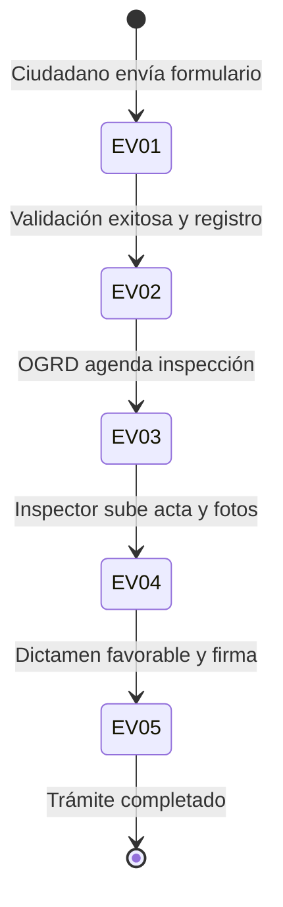

# TOGAF ADM — Catálogo de Eventos de Negocio (Business Events)

**Organización:** Municipalidad Distrital  
**Proyecto:** Plataforma Integral de Licencias y Gestión Territorial  
**Documento:** 15 — Catálogo de Eventos  
**Fecha:** 2026-09-25  

---

## 1. Ciclo de Vida Conducido por Eventos

La plataforma opera bajo un modelo reactivo donde los eventos de negocio desencadenan transiciones en la máquina de estados del workflow, actualizaciones de base de datos y despachos de notificaciones asíncronas:

---

## 2. Fichas de los 5 Eventos de Negocio Principales

| ID | Nombre del Evento | Disparador (Trigger) | Actor Generador | Receptores del Evento | Acciones Automáticas del Sistema |
|----|-------------------|----------------------|-----------------|-----------------------|-----------------------------------|
| **EV-01** | **Ciudadano solicita licencia** | El usuario presiona "Confirmar y Enviar Solicitud" en el portal web tras adjuntar los documentos obligatorios. | Ciudadano / Empresa | Sistema Backend, Mesa de Partes Virtual, SGDEL | 1. Valida payload con `StoreLicenciaRequest`. 2. Consulta PIDE (RENIEC/SUNAT). 3. Crea registro en `licencias_funcionamiento` en estado `BORRADOR`. 4. Dispara Job `EnviarNotificacionJob` con mailable `LicenciaCreadaMail`. |
| **EV-02** | **Municipio recibe solicitud** | El revisor de SGDEL comprueba la admisibilidad de los requisitos y confirma el pase a evaluación técnica. | Revisor de SGDEL | Administrado, OGRD | 1. Cambia estado a `EN_REVISION` en `WorkflowLicenciaService`. 2. Inserta fila inmutable en `workflow_licencia_historial`. 3. Genera el correlativo oficial del expediente municipal. 4. Envía notificación de recepción conforme con plazos TUPA estimados. |
| **EV-03** | **Inspector asigna fecha** | El coordinador de OGRD o el inspector asignado selecciona la fecha y franja horaria para la visita técnica ITSE. | Inspector / Coordinador OGRD | Administrado, Inspector asignado | 1. Crea registro en tabla `inspecciones` con estado `PROGRAMADA`. 2. Transiciona licencia a `INSPECCION_PROGRAMADA`. 3. Dispara email `InspeccionProgramadaMail` indicando fecha, hora, nombre y credencial del inspector. |
| **EV-04** | **Inspector completa inspección** | El inspector concluye la visita de campo, firma el acta digital y presiona "Finalizar Inspección" subiendo las fotos. | Inspector Municipal | SGDEL, Administrado, Coordinador OGRD | 1. Actualiza estado de la inspección a `COMPLETADA` y registra el `resultado`. 2. Vincula registros en `inspeccion_evidencias` y `inspeccion_observaciones`. 3. Transiciona la licencia a `INSPECCION_REALIZADA` (o `OBSERVADO` si hay faltas). 4. Si está observado, dispara `LicenciaObservadaMail` con detalle de subsanaciones. |
| **EV-05** | **Licencia emitida** | El Jefe de Licencias firma la resolución administrativa favorable y autoriza la entrega del título habilitante. | Jefe de Licencias (SGDEL) | Administrado, Catastro, Fiscalización | 1. Actualiza estado de la licencia a `EMITIDO` en `WorkflowLicenciaService`. 2. Registra evento en `workflow_licencia_historial`. 3. Genera documento PDF con código QR y sello de tiempo. 4. Dispara email `LicenciaEmitidaMail` con enlace seguro de descarga directa. |
