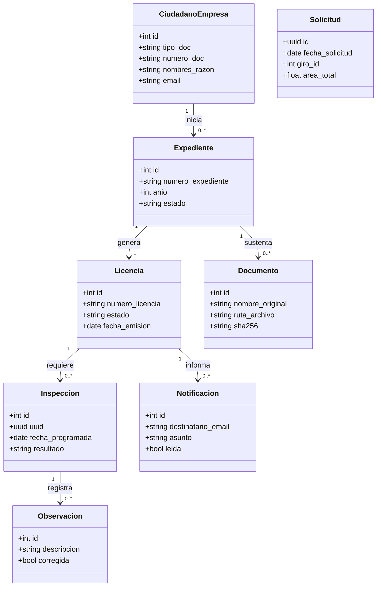

# TOGAF ADM — Catálogo de Objetos de Negocio (Business Objects)

**Organización:** Municipalidad Distrital  
**Proyecto:** Plataforma Integral de Licencias y Gestión Territorial  
**Documento:** 16 — Catálogo de Objetos  
**Fecha:** 2026-09-25  

---

## 1. Modelo de Objetos de Negocio y Entidades Físicas

Los Objetos de Negocio representan la información medular manipulada a lo largo del proceso municipal. Cada objeto de negocio se materializa en una o más entidades físicas del Backend Laravel:

---

## 2. Catálogo Detallado de los 8 Objetos de Negocio

| ID | Objeto de Negocio | Definición | Atributos Clave | Ciclo de Vida (Estados) | Entidad Físico en BD |
|----|-------------------|------------|-----------------|-------------------------|----------------------|
| **BO-01** | **Ciudadano / Empresa** | Sujeto de derecho que actúa como administrado ante la municipalidad (persona natural o jurídica). | `id`, `tipo_documento_id`, `numero_documento`, `nombres`, `apellidos`, `razon_social`, `email`, `telefono`. | `ACTIVO`, `INACTIVO`, `BLOQUEADO` | Tabla `personas` / `persona_documentos` / `auth_user` |
| **BO-02** | **Solicitud** | Manifestación formal de la pretensión administrativa con indicación del local y actividad económica. | `id`, `persona_id`, `giro_id`, `zonificacion_id`, `area_m2`, `direccion_establecimiento`, `nivel_riesgo_id`. | `BORRADOR`, `PRESENTADA`, `ADMITIDA` | Tabla `licencias_funcionamiento` (campos base) |
| **BO-03** | **Expediente** | Unidad estructurada de información y archivo que compila todos los documentos y actuaciones. | `id`, `numero_expediente`, `anio`, `persona_id`, `tipo_procedimiento_tupa_id`, `estado_id`, `fecha_apertura`. | `ABIERTO`, `EN_TRAMITE`, `RESUELTO`, `ARCHIVADO` | Tabla `expedientes` |
| **BO-04** | **Licencia** | Acto administrativo y credencial oficial que habilita el funcionamiento legal del establecimiento. | `id`, `expediente_id`, `numero_licencia`, `estado`, `fecha_emision`, `fecha_vencimiento`, `codigo_qr_hash`. | `BORRADOR`, `EN_REVISION`, `OBSERVADO`, `PENDIENTE_INSPECCION`, `INSPECCION_PROGRAMADA`, `INSPECCION_REALIZADA`, `APROBADO`, `RECHAZADO`, `EMITIDO`, `ANULADO` | Tabla `licencias_funcionamiento` + `workflow_licencia_historial` |
| **BO-05** | **Inspección** | Diligencia técnica in-situ realizada para comprobar las condiciones de seguridad de la edificación (ITSE). | `id`, `uuid`, `licencia_id`, `inspector_id`, `fecha_programada`, `fecha_realizada`, `estado`, `resultado`, `observaciones`. | `PROGRAMADA`, `EN_PROCESO`, `COMPLETADA`, `REPROGRAMADA`, `CANCELADA` | Tabla `inspecciones` |
| **BO-06** | **Observación** | Incumplimiento técnico detectado durante la inspección que impide la emisión inmediata. | `id`, `inspeccion_id`, `descripcion`, `plazo_dias`, `corregida`, `fecha_correccion`, `evidencia_correccion_ruta`. | `PENDIENTE`, `CORREGIDA`, `VENCIDA_NO_CORREGIDA` | Tabla `inspeccion_observaciones` |
| **BO-07** | **Documento** | Archivo digital cargado como sustento legal o técnico del expediente (PDF, imagen). | `id`, `uuid`, `nombre_original`, `ruta_archivo`, `tipo_mime`, `tamanio_bytes`, `sha256`, `fecha_subida`. | `CARGADO`, `VALIDADO`, `OBSERVADO`, `DESCARTADO` | Tabla `expediente_archivos` / `inspeccion_evidencias` |
| **BO-08** | **Notificación** | Comunicación formal despachada al administrado o inspector informando un hito procesal. | `id`, `destinatario_email`, `destinatario_id`, `asunto`, `cuerpo`, `tipo`, `leida`, `fecha_envio`, `fecha_lectura`. | `PENDIENTE_ENVIO`, `ENVIADA`, `FALLIDA`, `LEIDA` | Tabla `notificaciones` |
