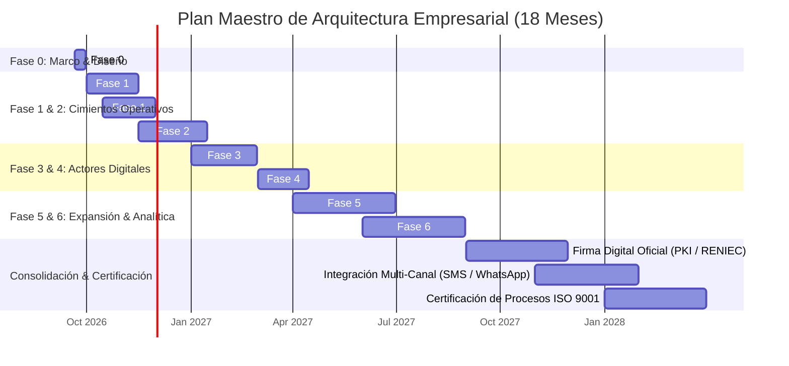

# TOGAF ADM — Hoja de Ruta de Implementación de Arquitectura (Roadmap 18 Meses)

**Organización:** Municipalidad Distrital  
**Proyecto:** Plataforma Integral de Licencias y Gestión Territorial  
**Documento:** 17 — Roadmap  
**Fecha:** 2026-09-25  

---

## 1. Cronograma Visual de Fases y Paquetes de Trabajo

---

## 2. Detalle de Hitos por Horizonte Temporal

### Horizonte 1: Corto Plazo (Meses 0 a 6) — Operación Digital Central
- **Mes 1 (Octubre 2026):**
  - Implementación del `WorkflowLicenciaService` con los 10 estados deterministas y matriz de transiciones.
  - Creación de la tabla `workflow_licencia_historial` y `workflow_transiciones_permitidas`.
  - Despliegue de los mailers y templates Blade para notificaciones por correo electrónico.
- **Mes 2-3 (Noviembre - Diciembre 2026):**
  - Desarrollo del módulo de Inspecciones Técnicas: tablas `inspecciones`, `inspeccion_evidencias`, `inspeccion_observaciones`.
  - Pruebas de campo con tablets para captura fotográfica in-situ y cálculo de SHA-256.
- **Mes 4-5 (Enero - Febrero 2027):**
  - Lanzamiento del Portal Ciudadano responsive: registro e inicio de trámites con validación PIDE en tiempo real.
  - Implementación de la consulta pública de estado de expediente sin requerir login.
- **Mes 6 (Marzo 2027):**
  - **HITO 1 (M1):** Pase a producción del flujo completo de Licencias de Funcionamiento e ITSE. Apagado de la recepción de expedientes en papel en ventanilla.

### Horizonte 2: Mediano Plazo (Meses 6 a 12) — Especialización y Obras
- **Mes 7-8 (Abril - Mayo 2027):**
  - Habilitación del Rol Especialista Técnico para revisión de memorias descriptivas y planos arquitectónicos en riesgo Alto/Muy Alto.
  - Modelado y desarrollo del módulo de Licencias de Construcción (predios, linderos, parámetros urbanísticos).
- **Mes 9-10 (Junio - Julio 2027):**
  - Despliegue del módulo de Auditoría Forense y registro de trazabilidad integral.
  - Construcción del Dashboard BI inicial con métricas de tiempos de atención y cuellos de botella.
- **Mes 11-12 (Agosto - Septiembre 2027):**
  - **HITO 2 (M2):** Unificación de Obras Privadas y Licencias Comerciales sobre la plataforma única. Medición del KPI-01 (≤ 15 min) y KPI-02 (≥ 70% digital).

### Horizonte 3: Largo Plazo (Meses 12 a 18) — Confianza Digital y Expansión
- **Mes 13-14 (Octubre - Noviembre 2027):**
  - Integración con componente de Firma Digital acreditada por Indecopi / RENIEC para certificados PDF oficiales con valor probatorio legal.
- **Mes 15-16 (Diciembre 2027 - Enero 2028):**
  - Incorporación de canal complementario de notificaciones inmediatas por mensajería móvil (SMS y WhatsApp Business API).
- **Mes 17-18 (Febrero - Marzo 2028):**
  - **HITO 3 (M3):** Certificación del Sistema de Gestión de Calidad (ISO 9001:2015) para los trámites de habilitación urbana y comercial.
