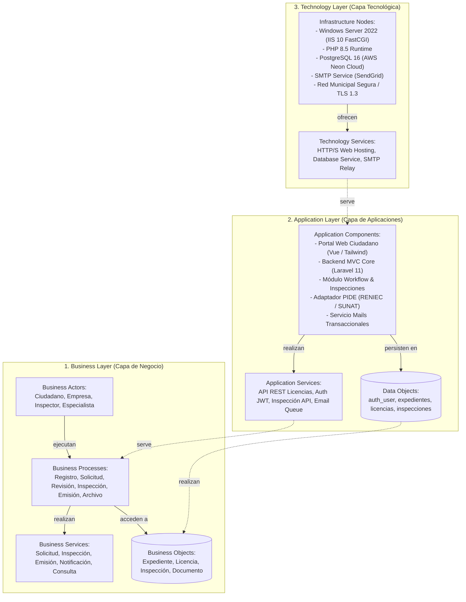

# TOGAF ADM — Modelo de Arquitectura Empresarial ArchiMate 3.1

**Organización:** Municipalidad Distrital  
**Proyecto:** Plataforma Integral de Licencias y Gestión Territorial  
**Documento:** 18 — Modelo ArchiMate  
**Fecha:** 2026-09-25  

---

## 1. Visión Multinivel Integrada (Business, Application, Technology)

El modelo ArchiMate estructura la arquitectura en 3 capas jerárquicas vinculadas por relaciones de realización (*realization*), servicio (*serving*) y acceso (*access*):

---

## 2. Detalle por Capa ArchiMate

### 2.1 Capa de Negocio (Business Layer)
- **Actores y Roles de Negocio:**
  * `Ciudadano` / `Empresa`: Roles externos generadores de demanda de trámite.
  * `Inspector Municipal`: Rol de campo asignado a la verificación de riesgo en edificaciones.
  * `Especialista Técnico`: Rol revisor de expedientes y planos de obras.
  * `Jefe de Licencias`: Autoridad resolutiva de aprobación y emisión.
- **Servicios de Negocio:**
  * `BS_Solicitud`: Recepción y validación preliminar de expediente.
  * `BS_Inspeccion`: Dictamen in-situ de condiciones de seguridad (ITSE).
  * `BS_Emision`: Otorgamiento formal del título habilitante municipal.
  * `BS_Notificacion`: Alertas tempranas al administrado en cada hito del proceso.
  * `BS_Consulta`: Verificación pública de estados de trámite 24/7.
- **Procesos de Negocio:** Secuencia de 10 procesos estándar regidos por la máquina de estados.

### 2.2 Capa de Aplicaciones (Application Layer)
- **Componentes de Aplicación:**
  * `Portal Ciudadano`: Aplicación web SPA (Single Page Application) responsiva.
  * `Backend MVC (Laravel 11)`: API RESTful monolítica modular con 18 dominios funcionales planos.
  * `Workflow Engine`: Servicio interno determinista para el cambio y auditoría de estados.
  * `Inspeccion Module`: Controlador y servicio para gestión de agenda y carga de evidencias binarias.
  * `PIDE Gateway`: Cliente HTTP con caché para consumo de servicios web de RENIEC y SUNAT.
- **Objetos de Datos:** Entidades Eloquent normalizadas (`Expediente`, `LicenciaFuncionamiento`, `Inspeccion`, `Archivo`).

### 2.3 Capa Tecnológica (Technology Layer)
- **Nodos de Dispositivo y Ejecución:**
  * `SRV-MUNI-IIS`: Servidor Windows Server 2022 ejecutando IIS 10 con módulo FastCGI.
  * `PHP-RUNTIME`: PHP 8.5 x64 con extensiones `pdo_pgsql`, `mbstring`, `openssl`, `curl`.
  * `DB-CLUSTER-NEON`: PostgreSQL 16 serverless en AWS Neon con réplicas de lectura y PITR.
  * `MAIL-RELAY`: Agente SMTP SendGrid con autenticación segura TLS en puerto 587.
- **Servicios Tecnológicos:** Enrutamiento HTTP/HTTPS mediante TLS 1.3, persistencia relacional transaccional y encolado de mensajes asíncronos.
